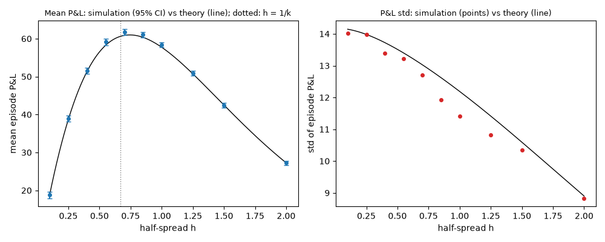
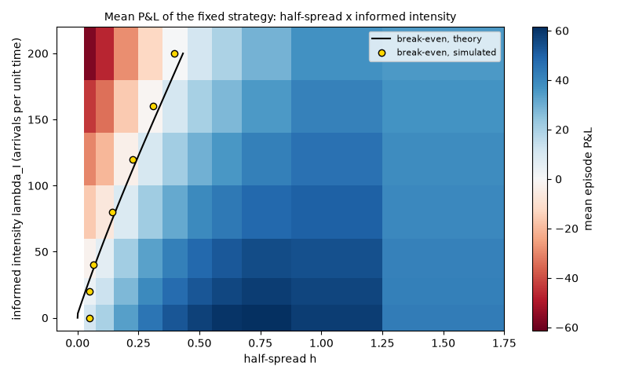
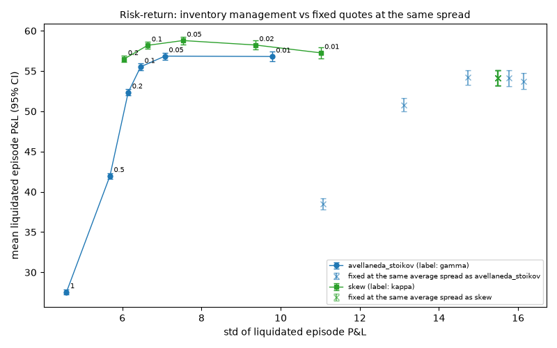

# mm-sim — a market-making simulator lab

I built this to understand market making by building it: a simulated asset, a market maker
that posts a bid and an ask, and order flow from uninformed (noise) traders and from informed
traders who know where the price is going. Five pre-registered experiments measure how the
spread, adverse selection, inventory management and latency drive the market maker's P&L.

**Simulation only.** No exchange, no broker, no orders, no API keys, no real money. Every
conclusion below is a conclusion about this model, not about real markets. Parameters are
invented, not calibrated.

## The model in five lines

1. The true value follows a random walk (optionally with jumps), or is one of two values
   fixed for the episode.
2. The market maker quotes one lot on each side; it sees the value as a public mid price, or
   only the trade tape in the two-value world.
3. Noise traders hit a quote at distance `δ` from the mid with probability
   `1 − exp(−A·exp(−k·δ)·dt)` per step; informed traders trade only when the quote is wrong
   against the value they know a few steps ahead.
4. Each step: the market maker (re)quotes, informed traders act, noise traders act, the value
   moves. Inventory is limited; final inventory is marked to the true value and, optionally,
   liquidated at a cost.
5. Every fill's P&L splits exactly into spread capture, the short-term move after the fill
   (adverse selection when negative) and later holding P&L.

Full description, derivations and sources: [docs/model_notes.md](docs/model_notes.md).

## Three figures

**1. Wider quotes earn more per fill and fill less often** (EXP-001: mean P&L against the
half-spread, noise traders only; line = closed form).



**2. Informed traders set a break-even spread** (EXP-002: mean P&L over half-spread ×
informed intensity; red = the market maker loses).



**3. Managing inventory moves the whole risk–return trade-off** (EXP-003: each point against
fixed quotes with the same average spread, on the same random numbers).



## Results (statements about the model)

Each experiment was written down with its pass/fail numbers before it ran, ran once, and can
be rebuilt and checked with `make figures`. 1000 episodes of 200 steps per grid point; 95%
confidence intervals.

| Experiment | Question | Result | Files |
|---|---|---|---|
| EXP-001 | Fixed spread against noise traders: does mean P&L follow the closed form, and where is the best half-spread? | CONFIRMED. Within 2.1 standard errors of the formula at all 10 half-spreads (seed 101). Best grid point h = 0.7: mean P&L 61.70 [60.91, 62.49]; the formula's optimum is 0.744, not the textbook 1/k = 0.667. | [report](reports/experiments/EXP-001/report.md), [pre-registration](experiments/EXP-001_fixed_spread_noise_only.md) |
| EXP-002 | How wide must a fixed spread be to break even as informed traders arrive more often? | CONFIRMED. Within 3.1 standard errors of the formula in all 70 cells (seed 202). The break-even half-spread rises from 0.064 (an informed trader in 20% of steps) to 0.396 (in every step); predicted 0.071 to 0.433. | [report](reports/experiments/EXP-002/report.md), [pre-registration](experiments/EXP-002_spread_vs_informed_intensity.md) |
| EXP-003 | What does inventory management buy against fixed quotes with the same average spread? | CONFIRMED. Avellaneda–Stoikov (γ = 0.1) cuts the std of liquidated P&L to 0.417 of the benchmark's [0.374, 0.464] (seed 303). Mark-to-market it gives up about 5.7% of mean P&L (57.16 against 60.64). A plain inventory skew does at least as well here. | [report](reports/experiments/EXP-003/report.md), [pre-registration](experiments/EXP-003_inventory_frontier.md) |
| EXP-004 | What do stale quotes cost when the price jumps? | CONFIRMED. Requoting every 5 steps instead of every step: mean P&L 54.70 [53.47, 55.93] against 61.30 [60.23, 62.38], with 5.66 pick-offs per episode losing 0.35 each (seed 404). Every 20 steps: 30.07. Matches the closed form. | [report](reports/experiments/EXP-004/report.md), [pre-registration](experiments/EXP-004_latency_and_jumps.md) |
| EXP-005 | Do these conclusions survive other assumptions (volatility doubled, fill decay `k` doubled, jumps)? | CONFIRMED. All six conclusions keep their sign, CI excluding zero, in all four variants; none is fragile (seed 505). The sizes change a lot: doubling volatility triples the loss of a narrow spread to informed flow (−21.6 to −68.5). | [report](reports/experiments/EXP-005/report.md), [pre-registration](experiments/EXP-005_robustness.md) |

Also checked, in tests rather than experiments: a Glosten–Milgrom market maker in the
two-value world has zero mean P&L, and its first spread equals the informed share times the
value range (`tests/test_informed_and_gm.py`).

Runs and grid points tried in total: 157 (every line of
[experiments/trial_log.csv](experiments/trial_log.csv)).

## Limitations

- **A model, not a market.** One market maker, no order book, no queue position, no
  competitors, one-lot orders, no hedging.
- **The fill model is assumed**: exponential in the quote's distance from the mid. The
  location of the best spread comes straight from that shape.
- **Informed traders are simple**: they know the value a fixed number of steps ahead and
  always trade when it pays. Their horizon and arrival rate are invented.
- **The market maker is given things it would have to estimate**: the true value as a mid
  price, and (for Avellaneda–Stoikov) the true volatility and `k`.
- **Latency is only a requote interval**; there is no race between traders.
- **One seed per experiment.** Grid points inside an experiment share random numbers, so they
  are not independent. Two things this left open are recorded in the experiment files: in
  EXP-001 every simulated std is slightly below the variance formula, and in EXP-002 every
  cell is about two standard errors above theory.
- **Process.** EXP-001 was approved by me. EXP-002 to EXP-005 were approved under
  delegation during an overnight run, not by me.

## Reproduce

```bash
uv sync                # Python 3.13 environment from the lockfile
make check             # ruff, mypy --strict, tests (about half a minute)
make figures           # rebuild every experiment report and figure; fails if a number differs
```

Other commands:

```bash
uv run mm-sim check-config --scenario baseline   # validated config and its hash
uv run mm-sim run --scenario toxic --strategy fixed --seed 1    # -> reports/runs/<run_id>/
uv run mm-sim run --scenario inventory --strategy skew --engine fast
uv run mm-sim play --scenario two_point_easy     # quote against the flow yourself
uv run mm-sim benchmark                          # both engines, steps per second
```

A new experiment is a new file in `experiments/` (copy the template); the code refuses to run
it until it is approved and its config hash matches.

## Where to look

| Path | What |
|---|---|
| [src/mm_sim/engine/reference.py](src/mm_sim/engine/reference.py) | the reference engine: one episode, step by step. Start here. |
| [src/mm_sim/accounting/pnl.py](src/mm_sim/accounting/pnl.py) | P&L, its decomposition, markouts |
| [src/mm_sim/strategies/](src/mm_sim/strategies/) | fixed, skew, Avellaneda–Stoikov, Glosten–Milgrom; one file each |
| [src/mm_sim/flow/](src/mm_sim/flow/) | noise and informed traders |
| [src/mm_sim/analysis/theory.py](src/mm_sim/analysis/theory.py) | closed forms the simulations are checked against |
| [src/mm_sim/engine/fast.py](src/mm_sim/engine/fast.py) | vectorised engine, same results, 13 to 28 times faster ([docs/performance.md](docs/performance.md)) |
| [tests/](tests/) | hand-computed engine steps, property tests, the look-ahead test with a cheating control |
| [experiments/](experiments/) | pre-registrations with results, and the trial log |
| [docs/](docs/) | [model notes](docs/model_notes.md), [concepts](docs/concepts.md), [decisions](docs/decisions.md), [interview prep](docs/interview_prep.md) |

## What I learned

- A market maker's income is the spread paid by traders who do not know more than it does;
  its costs are the traders who do, and the inventory it is left holding. The decomposition
  table makes that visible in every run.
- "How wide should I quote?" has no single answer. Against noise it is a trade-off between
  edge and fill rate; against informed flow there is a floor below which every extra fill
  loses money.
- Fill count and spread capture are bad scorecards. Both go *up* when informed traders or
  stale quotes are the reason for the fills.
- Most of the risk is inventory, and leaning quotes against the position removes more than
  half of it cheaply. The model-derived strategy was not better than the simple rule once the
  objective changed slightly.
- A simulator will confirm whatever you rerun it for. Writing the prediction down first,
  checking against a closed form, and keeping a cheating strategy around to prove the tests
  can fail caught real mistakes during the build: a closed form that was wrong by 14 standard
  errors, and rows of agreeing results that were one shared fluctuation, not many
  confirmations ([docs/decisions.md](docs/decisions.md)).
