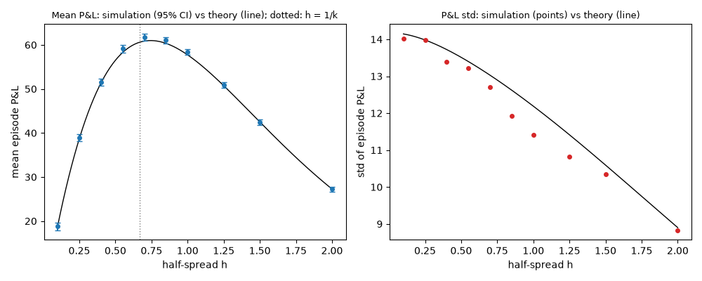

# EXP-001: Fixed half-spread against noise flow only: P&L mean and std versus theory

## Limitations (read first)

Everything below is a statement about a **model**, not about real markets.

- Fill probability is an assumed exponential function of the quote's distance from the mid.
- Orders are one lot. There is no order book, no queue position and no competing market maker.
- The market maker sees the true value as a public mid price (in the `public_mid` world).
- Strategies that use the volatility `sigma` or the flow parameter `k` are given the true values.
- Informed traders' horizon and threshold are invented parameters, not calibrated to data.
- No hedging, no correlated instruments. Latency exists only through `requote_every`.
- Parameters are not calibrated to any market; P&L units are arbitrary.

This experiment has noise traders only: no informed flow, no jumps, no latency, no fees.

## Setup

- scenario: `baseline`, config hash `98f30782c37f`
- run id `20261109T212048Z-f0ee9c`, git commit `6c91285cc39c`
- root seed 101, 1000 episodes
- variants tried so far in this repository (lines in `experiments/trial_log.csv`): 11
- strategy `fixed`, grid `{"half_spread": [0.1, 0.25, 0.4, 0.55, 0.7, 0.85, 1.0, 1.25, 1.5, 2.0]}`; every grid point uses the same seed (common random numbers)
- pre-registered in `experiments/` as EXP-001, approved by Nick on 2026-11-09

## Results

| h | mean P&L | 95% CI | theory | z | paired z | std | theory std | ratio | fills | theory fills | at limit |
|---|---|---|---|---|---|---|---|---|---|---|---|
| 0.1 | 18.82 | [17.95, 19.69] | 18.90 | -0.19 | -0.18 | 14.02 | 14.15 | 0.991 | 180.2 | 180.0 | 0.0000 |
| 0.25 | 38.92 | [38.06, 39.79] | 38.73 | 0.45 | 0.46 | 13.97 | 13.98 | 0.999 | 152.1 | 151.9 | 0.0000 |
| 0.4 | 51.52 | [50.69, 52.35] | 51.36 | 0.38 | 0.38 | 13.39 | 13.72 | 0.976 | 127.0 | 126.8 | 0.0000 |
| 0.55 | 59.12 | [58.30, 59.94] | 58.27 | 2.03 | 2.03 | 13.22 | 13.40 | 0.987 | 105.4 | 105.0 | 0.0000 |
| 0.7 | 61.70 | [60.91, 62.49] | 60.86 | 2.09 | 2.09 | 12.70 | 13.03 | 0.975 | 86.8 | 86.3 | 0.0000 |
| 0.85 | 61.04 | [60.30, 61.78] | 60.35 | 1.83 | 1.83 | 11.92 | 12.62 | 0.944 | 70.8 | 70.6 | 0.0000 |
| 1 | 58.38 | [57.68, 59.09] | 57.73 | 1.81 | 1.81 | 11.42 | 12.19 | 0.937 | 57.5 | 57.4 | 0.0000 |
| 1.25 | 50.94 | [50.26, 51.61] | 50.74 | 0.59 | 0.58 | 10.82 | 11.41 | 0.948 | 40.4 | 40.4 | 0.0000 |
| 1.5 | 42.44 | [41.80, 43.08] | 42.51 | -0.22 | -0.22 | 10.34 | 10.59 | 0.976 | 28.1 | 28.2 | 0.0000 |
| 2 | 27.22 | [26.67, 27.77] | 27.27 | -0.16 | -0.16 | 8.83 | 8.90 | 0.992 | 13.5 | 13.6 | 0.0000 |

`theory` averages the closed form over the tick offset; `z` = (mean - theory) / standard error; `paired z` tests P&L minus its expectation given the actual quotes; `at limit` is the share of steps at the inventory limit (the theory assumes it is 0).

Highest simulated mean P&L: h = 0.7. Continuous optimum of the closed form: h = 0.749; 1/k = 0.667.

## Verdict against the pre-registered hypothesis

- PASS: C1 mean matches theory (|z| <= 3.5 at every grid point)
- PASS: C2 best simulated half-spread is the theory's best grid point or its neighbour
- PASS: C3a std within 10% of theory at every grid point
- PASS: C3b std at the widest half-spread is below std at the narrowest

**CONFIRMED**

## What depends on the model's assumptions

- The optimum near 1/k is a property of the exponential fill intensity. Another intensity shape gives another optimum.
- With noise traders only, a narrower spread is never punished by informed flow; EXP-002 adds it.
- P&L std comes almost entirely from carried inventory on a random-walk value; with no inventory control it grows with the number of fills.
