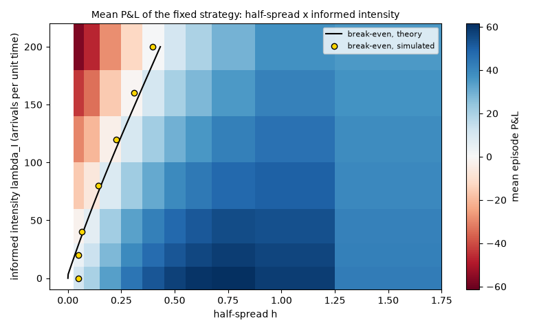

# EXP-002: Fixed half-spread against informed flow: mean P&L heatmap and break-even line

## Limitations (read first)

Everything below is a statement about a **model**, not about real markets.

- Fill probability is an assumed exponential function of the quote's distance from the mid.
- Orders are one lot. There is no order book, no queue position and no competing market maker.
- The market maker sees the true value as a public mid price (in the `public_mid` world).
- Strategies that use the volatility `sigma` or the flow parameter `k` are given the true values.
- Informed traders' horizon and threshold are invented parameters, not calibrated to data.
- No hedging, no correlated instruments. Latency exists only through `requote_every`.
- Parameters are not calibrated to any market; P&L units are arbitrary.

Specific to this experiment: informed traders know the value 50 steps ahead and trade whenever the quote is wrong by more than 0. Both numbers are invented. The break-even spreads below scale with them.

## Setup

- scenario: `toxic`, config hash `92ddd4ad4197`
- run id `20261109T213355Z-c3f5f0`, git commit `2c0240941c5c`
- root seed 202, 1000 episodes
- variants tried so far in this repository (lines in `experiments/trial_log.csv`): 84
- strategy `fixed`, half-spreads `{"half_spread": [0.05, 0.1, 0.2, 0.3, 0.4, 0.5, 0.6, 0.75, 1.0, 1.5]}`, informed intensities `{"flow.informed.intensity": [0.0, 20.0, 40.0, 80.0, 120.0, 160.0, 200.0]}`; every cell uses the same seed
- pre-registered as EXP-002, approved by delegation during an overnight run on 2026-11-09

## Results: mean episode P&L (rows: informed intensity, columns: half-spread)

| lambda_I | h=0.05 | h=0.1 | h=0.2 | h=0.3 | h=0.4 | h=0.5 | h=0.6 | h=0.75 | h=1 | h=1.5 |
|---|---|---|---|---|---|---|---|---|---|---|
| 0 | 11.1 | 19.8 | 34.0 | 44.8 | 52.4 | 57.3 | 60.2 | 61.5 | 58.6 | 43.0 |
| 20 | 4.2 | 13.1 | 27.7 | 39.0 | 47.2 | 52.7 | 56.2 | 58.2 | 56.4 | 42.1 |
| 40 | -2.6 | 6.4 | 21.4 | 33.2 | 42.0 | 48.2 | 52.1 | 54.9 | 54.2 | 41.3 |
| 80 | -16.2 | -6.8 | 9.0 | 21.8 | 31.6 | 39.0 | 44.0 | 48.4 | 50.0 | 39.8 |
| 120 | -30.0 | -20.4 | -3.7 | 10.3 | 21.2 | 29.8 | 35.9 | 41.9 | 45.8 | 38.5 |
| 160 | -43.7 | -33.7 | -16.2 | -1.2 | 10.7 | 20.5 | 27.8 | 35.4 | 41.4 | 36.9 |
| 200 | -57.3 | -46.8 | -28.6 | -12.6 | 0.5 | 11.2 | 19.6 | 28.9 | 37.1 | 35.4 |

Confidence intervals, theory values and z-scores for all 70 cells are in `cells.csv`. Largest |z| against theory: 3.10 at lambda_I=40, h=0.4. Largest share of steps at the inventory limit: 0.0000.

## Break-even half-spread

| lambda_I | arrival prob. per step | simulated | theory | difference |
|---|---|---|---|---|
| 0 | 0.00 | 0.050 | 0.000 | 0.050 |
| 20 | 0.10 | 0.050 | 0.032 | 0.018 |
| 40 | 0.20 | 0.064 | 0.071 | -0.007 |
| 80 | 0.40 | 0.143 | 0.154 | -0.011 |
| 120 | 0.60 | 0.226 | 0.244 | -0.017 |
| 160 | 0.80 | 0.310 | 0.337 | -0.027 |
| 200 | 1.00 | 0.396 | 0.433 | -0.036 |

`simulated` is the first zero of the mean P&L, linearly interpolated between grid points; where the mean is already positive at the smallest half-spread it is that half-spread (an upper bound).

## P&L decomposition along the grid (mean per episode)

| lambda_I | h | spread capture | short-term move (adverse selection) | inventory | informed fills | noise fills |
|---|---|---|---|---|---|---|
| 0 | 0.05 | 10.5 | 0.4 | 0.3 | 0.0 | 190.6 |
| 0 | 0.5 | 56.8 | 0.3 | 0.2 | 0.0 | 112.5 |
| 0 | 1.5 | 42.8 | 0.1 | 0.1 | 0.0 | 28.4 |
| 20 | 0.05 | 11.0 | -7.4 | 0.6 | 19.1 | 181.5 |
| 20 | 0.5 | 61.0 | -8.9 | 0.7 | 11.4 | 109.4 |
| 20 | 1.5 | 45.9 | -3.9 | 0.2 | 2.2 | 28.2 |
| 40 | 0.05 | 11.6 | -14.9 | 0.8 | 38.0 | 172.5 |
| 40 | 0.5 | 65.0 | -17.7 | 0.9 | 22.5 | 106.1 |
| 40 | 1.5 | 49.0 | -7.9 | 0.3 | 4.5 | 28.1 |
| 80 | 0.05 | 12.7 | -30.1 | 1.2 | 75.7 | 154.5 |
| 80 | 0.5 | 73.1 | -35.6 | 1.5 | 44.8 | 100.0 |
| 80 | 1.5 | 55.0 | -15.8 | 0.5 | 8.8 | 27.8 |
| 120 | 0.05 | 13.7 | -45.2 | 1.5 | 113.4 | 136.5 |
| 120 | 0.5 | 81.2 | -53.5 | 2.0 | 67.1 | 93.7 |
| 120 | 1.5 | 61.1 | -23.5 | 0.9 | 13.1 | 27.5 |
| 160 | 0.05 | 14.8 | -60.6 | 2.0 | 151.5 | 118.3 |
| 160 | 0.5 | 89.4 | -71.5 | 2.6 | 89.7 | 87.4 |
| 160 | 1.5 | 67.3 | -31.5 | 1.1 | 17.6 | 27.1 |
| 200 | 0.05 | 15.9 | -76.1 | 2.9 | 189.3 | 100.5 |
| 200 | 0.5 | 97.6 | -89.6 | 3.2 | 112.2 | 81.2 |
| 200 | 1.5 | 73.6 | -39.5 | 1.3 | 22.0 | 26.8 |

## Verdict against the pre-registered hypothesis

- PASS: C1 mean matches theory (|z| <= 4.0 in every cell)
- PASS: C2 simulated break-even within 0.05 of theory at every informed intensity > 0
- PASS: C3 simulated break-even rises with the informed intensity (where the theoretical break-even is inside the half-spread grid)
- no SUSPICIOUS flags

**CONFIRMED**

## What depends on the model's assumptions

- The size of the informed traders' edge is set by their horizon: they know a move of std sigma*sqrt(horizon*dt). A shorter horizon means a smaller edge and a narrower break-even spread.
- Informed traders here always trade when it pays and never hide; real informed flow is strategic (Kyle 1985) and partly indistinguishable from noise.
- The market maker never reacts: a fixed spread does not widen after being hit. Glosten-Milgrom quotes (the two-point world) do.
- Noise traders keep arriving at the same rate whatever the spread history.
