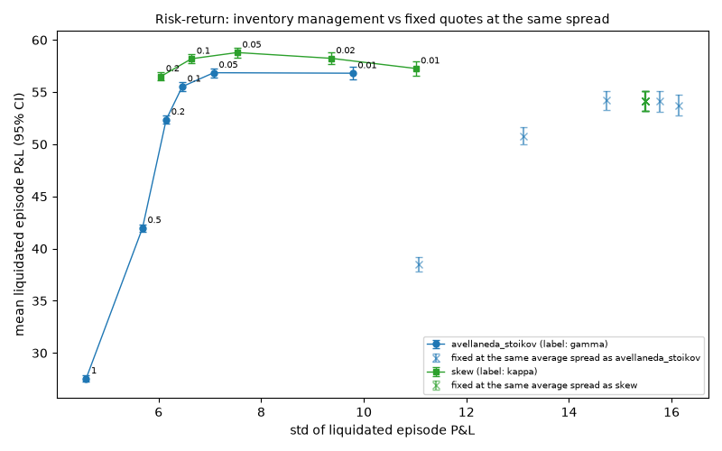
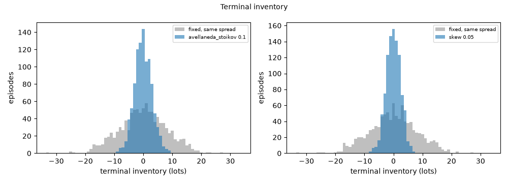
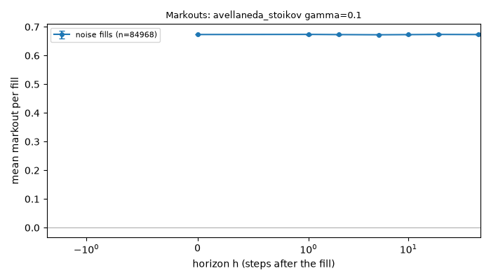
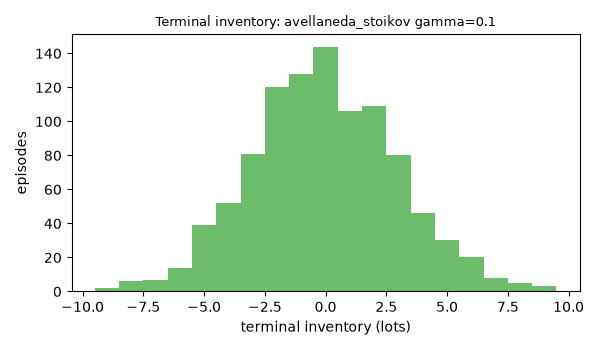
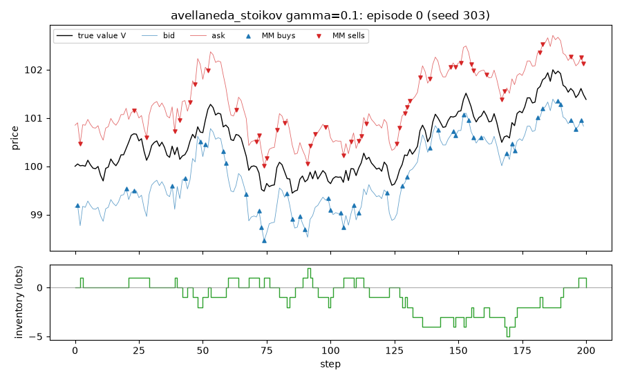

# EXP-003: Inventory management: Avellaneda-Stoikov and skew against fixed quotes at the same spread

## Limitations (read first)

Everything below is a statement about a **model**, not about real markets.

- Fill probability is an assumed exponential function of the quote's distance from the mid.
- Orders are one lot. There is no order book, no queue position and no competing market maker.
- The market maker sees the true value as a public mid price (in the `public_mid` world).
- Strategies that use the volatility `sigma` or the flow parameter `k` are given the true values.
- Informed traders' horizon and threshold are invented parameters, not calibrated to data.
- No hedging, no correlated instruments. Latency exists only through `requote_every`.
- Parameters are not calibrated to any market; P&L units are arbitrary.

Specific to this experiment: noise traders only (no informed flow, no jumps). The final inventory is closed at a cost of 0.5 + 0.05*|q| per lot, an invented number; with a zero cost, liquidated and mark-to-market P&L coincide. Avellaneda-Stoikov is given the true sigma and k.

## Setup

- scenario: `inventory`, config hash `462cf8b0d9ce`
- run id `20261109T214532Z-6561a4`, git commit `741ba8fd1ee7`
- root seed 303, 1000 episodes
- variants tried so far in this repository (lines in `experiments/trial_log.csv`): 172
- grids `{"gamma": [0.01, 0.05, 0.1, 0.2, 0.5, 1.0], "kappa": [0.01, 0.02, 0.05, 0.1, 0.2]}`; each variant is paired with `fixed` at half its average quoted spread, on the same seed (common random numbers)
- pre-registered as EXP-003, approved by delegation during an overnight run on 2026-11-09
- certainty equivalent with risk aversion 0.1; std-ratio and CE intervals by paired bootstrap over episodes (2000 resamples)

## Results: liquidated P&L per episode

| strategy | value | avg spread | mean [95% CI] | std | fixed: mean [95% CI] | fixed: std | std ratio [95% CI] | mean diff [95% CI] | CE | fixed: CE |
|---|---|---|---|---|---|---|---|---|---|---|
| avellaneda_stoikov | 0.01 | 1.359 | 56.81 [56.20, 57.42] | 9.78 | 53.74 [52.73, 54.74] | 16.14 | 0.606 [0.568, 0.650] | 3.08 [2.48, 3.67] | 48.51 | -9.62 |
| avellaneda_stoikov | 0.05 | 1.422 | 56.86 [56.42, 57.30] | 7.08 | 54.11 [53.13, 55.09] | 15.76 | 0.449 [0.407, 0.496] | 2.75 [1.92, 3.58] | 54.41 | -12.88 |
| avellaneda_stoikov | 0.1 | 1.502 | 55.53 [55.13, 55.93] | 6.46 | 54.13 [53.17, 55.09] | 15.49 | 0.417 [0.374, 0.464] | 1.40 [0.54, 2.26] | 53.52 | -18.84 |
| avellaneda_stoikov | 0.2 | 1.664 | 52.36 [51.98, 52.74] | 6.15 | 54.22 [53.30, 55.13] | 14.73 | 0.417 [0.377, 0.459] | -1.85 [-2.69, -1.02] | 50.59 | -4.84 |
| avellaneda_stoikov | 0.5 | 2.166 | 41.98 [41.63, 42.33] | 5.69 | 50.80 [49.99, 51.61] | 13.11 | 0.434 [0.398, 0.470] | -8.82 [-9.56, -8.08] | 40.44 | 18.55 |
| avellaneda_stoikov | 1 | 3.042 | 27.55 [27.26, 27.83] | 4.59 | 38.52 [37.84, 39.21] | 11.07 | 0.414 [0.384, 0.445] | -10.98 [-11.59, -10.36] | 26.53 | 29.29 |
| skew | 0.01 | 1.510 | 57.27 [56.58, 57.95] | 11.01 | 54.14 [53.18, 55.10] | 15.48 | 0.711 [0.673, 0.752] | 3.12 [2.70, 3.55] | 45.42 | -18.58 |
| skew | 0.02 | 1.510 | 58.24 [57.66, 58.82] | 9.36 | 54.14 [53.18, 55.10] | 15.48 | 0.605 [0.564, 0.649] | 4.10 [3.52, 4.68] | 52.61 | -18.58 |
| skew | 0.05 | 1.510 | 58.79 [58.33, 59.26] | 7.53 | 54.14 [53.18, 55.10] | 15.48 | 0.486 [0.440, 0.536] | 4.65 [3.88, 5.42] | 55.95 | -18.58 |
| skew | 0.1 | 1.510 | 58.20 [57.79, 58.61] | 6.64 | 54.14 [53.18, 55.10] | 15.48 | 0.429 [0.385, 0.477] | 4.06 [3.21, 4.90] | 56.08 | -18.58 |
| skew | 0.2 | 1.510 | 56.50 [56.13, 56.88] | 6.04 | 54.14 [53.18, 55.10] | 15.48 | 0.390 [0.350, 0.435] | 2.36 [1.48, 3.24] | 54.73 | -18.58 |

`mean diff` is the mean of the per-episode differences (strategy minus fixed). Pairing on common random numbers made its CI 0.36 to 0.86 times as wide as the unpaired CI would be.

## P&L decomposition and inventory (mean per episode)

| strategy | value | mark-to-market mean | fixed: MTM mean | std of terminal inventory | fixed: std of terminal inventory | share of steps at the limit |
|---|---|---|---|---|---|---|
| avellaneda_stoikov | 0.01 | 60.36 | 60.58 | 5.33 | 8.40 | 0.0000 |
| avellaneda_stoikov | 0.05 | 58.94 | 60.77 | 3.59 | 8.24 | 0.0000 |
| avellaneda_stoikov | 0.1 | 57.16 | 60.64 | 2.99 | 8.11 | 0.0000 |
| avellaneda_stoikov | 0.2 | 53.66 | 60.35 | 2.50 | 7.81 | 0.0000 |
| avellaneda_stoikov | 0.5 | 42.95 | 55.66 | 2.00 | 6.65 | 0.0000 |
| avellaneda_stoikov | 1 | 28.33 | 41.92 | 1.68 | 5.18 | 0.0000 |
| skew | 0.01 | 60.67 | 60.65 | 5.20 | 8.13 | 0.0000 |
| skew | 0.02 | 60.53 | 60.65 | 3.90 | 8.13 | 0.0000 |
| skew | 0.05 | 60.09 | 60.65 | 2.49 | 8.13 | 0.0000 |
| skew | 0.1 | 59.05 | 60.65 | 1.78 | 8.13 | 0.0000 |
| skew | 0.2 | 57.06 | 60.65 | 1.28 | 8.13 | 0.0000 |

The difference between mark-to-market and liquidated P&L is the cost of closing the final inventory.

## Representative grid point in detail: avellaneda_stoikov gamma=0.1

Strategy `avellaneda_stoikov {"gamma": 0.1}`, 1000 episodes. One grid point, shown so that the mechanics behind the table above are visible.

### P&L decomposition (mean per episode)

| part | mean | 95% CI |
|---|---|---|
| spread capture | 57.207 | [56.863, 57.552] |
| short-term move after fills (negative = adverse selection) | -0.027 | [-0.203, 0.149] |
| inventory / holding P&L | -0.025 | [-0.190, 0.140] |
| fees paid (subtracted) | 0.000 | [0.000, 0.000] |
| **total: mark-to-market P&L** | 57.156 | [56.768, 57.544] |

Decomposition horizon h = 10 steps. Identity check: the largest per-episode error of `spread + short-term + inventory - fees = P&L` is 2.84e-13.

### Markouts by counterparty (mean per fill)

| counterparty | fills | h | markout | 95% CI |
|---|---|---|---|---|
| noise | 84968 | 0 | 0.6733 | [0.6729, 0.6737] |
| noise | 84968 | 1 | 0.6737 | [0.6728, 0.6747] |
| noise | 84968 | 2 | 0.6731 | [0.6718, 0.6743] |
| noise | 84968 | 5 | 0.6724 | [0.6707, 0.6741] |
| noise | 84968 | 10 | 0.6730 | [0.6709, 0.6751] |
| noise | 84968 | 20 | 0.6736 | [0.6711, 0.6760] |
| noise | 84968 | 50 | 0.6732 | [0.6707, 0.6758] |

One episode is an illustration, not evidence.

## Verdict against the pre-registered hypothesis

- PASS: H1 std of liquidated P&L below the benchmark's (ratio CI below 1) for every AS gamma >= 0.1 and every skew kappa >= 0.05
- PASS: H2 AS gamma = 0.1 cuts the std by at least 25% (ratio CI below 0.75)
- PASS: H3 AS gamma = 0.1 costs at most 15% of the benchmark's mean liquidated P&L (paired CI)
- PASS: H4 AS gamma = 0.1 has a higher certainty equivalent than its benchmark (difference CI above 0)

**CONFIRMED**

## What depends on the model's assumptions

- The value is a martingale, so inventory earns nothing on average and reducing it is almost free. With a drift or with informed flow the trade-off changes.
- Skewing works because noise traders respond to price (the exponential fill intensity): a better price reliably attracts the offsetting trade.
- Avellaneda-Stoikov knows the true sigma and k and the horizon T; its spread widens early in the episode by construction.
- The size of the gain in liquidated P&L depends directly on the invented liquidation cost.
