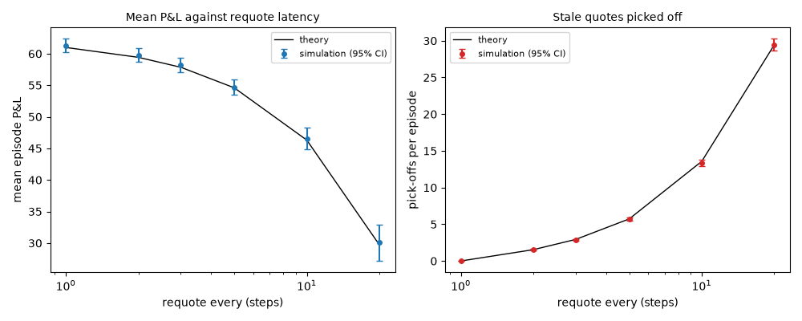
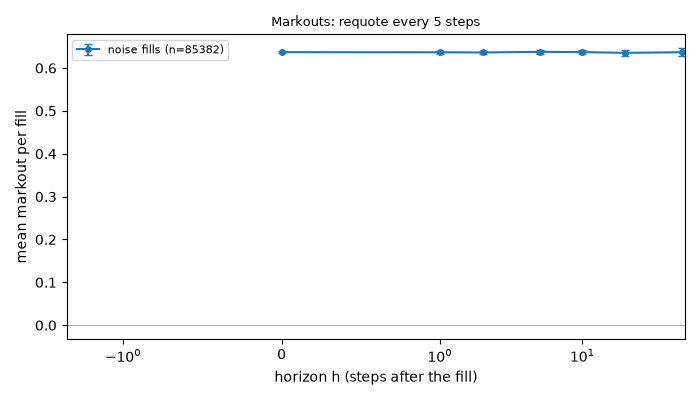
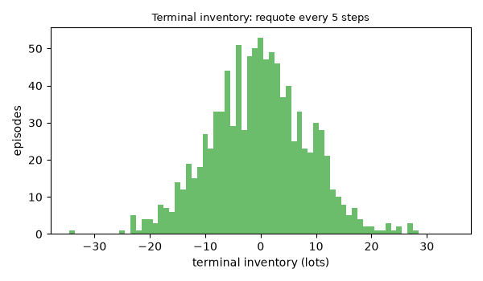
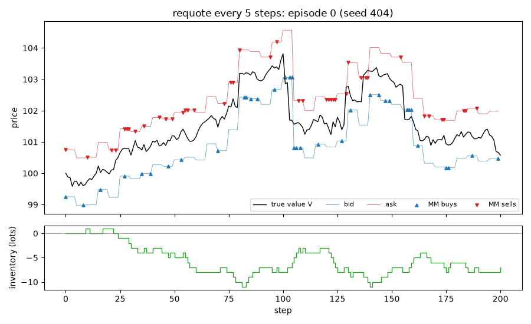

# EXP-004: Stale quotes: mean P&L and pick-offs against the requote interval, with jumps

## Limitations (read first)

Everything below is a statement about a **model**, not about real markets.

- Fill probability is an assumed exponential function of the quote's distance from the mid.
- Orders are one lot. There is no order book, no queue position and no competing market maker.
- The market maker sees the true value as a public mid price (in the `public_mid` world).
- Strategies that use the volatility `sigma` or the flow parameter `k` are given the true values.
- Informed traders' horizon and threshold are invented parameters, not calibrated to data.
- No hedging, no correlated instruments. Latency exists only through `requote_every`.
- Parameters are not calibrated to any market; P&L units are arbitrary.

Specific to this experiment: jumps of size 1 (fixed) arrive at rate 5 per unit time, invented numbers. Latency is only the requote interval: everyone else reacts instantly, and the 'fast' traders here are the ordinary noise traders, whose arrival rate rises steeply for a quote that is through the mid. There are no informed traders and no race between market makers.

## Setup

- scenario: `jumpy`, config hash `d1c8fe6df97e`
- run id `20261109T215912Z-134c11`, git commit `78f2f77fe3a0` (uncommitted changes)
- root seed 404, 1000 episodes
- variants tried so far in this repository (lines in `experiments/trial_log.csv`): 116
- strategy `fixed` (half-spread from the config), `{"engine.requote_every": [1.0, 2.0, 3.0, 5.0, 10.0, 20.0]}`; every grid point uses the same seed
- pre-registered as EXP-004, approved by delegation during an overnight run on 2026-11-09

## Results (per episode)

| requote every | mean P&L [95% CI] | theory | z | std | pick-offs [95% CI] | theory | z | edge per pick-off [95% CI] | fills | at limit |
|---|---|---|---|---|---|---|---|---|---|---|
| 1 | 61.30 [60.23, 62.38] | 60.98 | 0.58 | 17.30 | 0.00 [0.00, 0.00] | 0.00 | 0.00 | n/a | 80.6 | 0.0000 |
| 2 | 59.75 [58.66, 60.85] | 59.42 | 0.60 | 17.65 | 1.55 [1.47, 1.63] | 1.54 | 0.21 | -0.275 [-0.282, -0.269] | 82.0 | 0.0000 |
| 3 | 58.22 [57.11, 59.34] | 57.85 | 0.67 | 17.95 | 2.84 [2.71, 2.96] | 2.94 | -1.63 | -0.307 [-0.315, -0.300] | 83.1 | 0.0000 |
| 5 | 54.70 [53.47, 55.93] | 54.59 | 0.17 | 19.82 | 5.66 [5.44, 5.89] | 5.73 | -0.59 | -0.346 [-0.355, -0.338] | 85.4 | 0.0000 |
| 10 | 46.56 [44.85, 48.27] | 46.31 | 0.29 | 27.61 | 13.40 [12.96, 13.84] | 13.57 | -0.76 | -0.426 [-0.437, -0.415] | 91.2 | 0.0000 |
| 20 | 30.07 [27.16, 32.97] | 29.73 | 0.23 | 46.78 | 29.46 [28.64, 30.28] | 29.44 | 0.04 | -0.540 [-0.554, -0.526] | 100.6 | 0.0000 |

A pick-off is a fill on a quote posted at an earlier step that is on the wrong side of the current value (the market maker buys above it or sells below it). `edge per pick-off` is the average edge of those fills at the moment of the fill.

## Representative grid point in detail: requote every 5 steps

Strategy `fixed {"half_spread": 0.75}`, 1000 episodes. One grid point, shown so that the mechanics behind the table above are visible.

### P&L decomposition (mean per episode)

| part | mean | 95% CI |
|---|---|---|
| spread capture | 54.380 | [53.989, 54.772] |
| short-term move after fills (negative = adverse selection) | 0.016 | [-0.342, 0.373] |
| inventory / holding P&L | 0.301 | [-0.810, 1.412] |
| fees paid (subtracted) | 0.000 | [0.000, 0.000] |
| **total: mark-to-market P&L** | 54.697 | [53.467, 55.927] |

Decomposition horizon h = 10 steps. Identity check: the largest per-episode error of `spread + short-term + inventory - fees = P&L` is 2.07e-12.

### Markouts by counterparty (mean per fill)

| counterparty | fills | h | markout | 95% CI |
|---|---|---|---|---|
| noise | 85382 | 0 | 0.6369 | [0.6339, 0.6399] |
| noise | 85382 | 1 | 0.6366 | [0.6333, 0.6399] |
| noise | 85382 | 2 | 0.6362 | [0.6327, 0.6398] |
| noise | 85382 | 5 | 0.6377 | [0.6336, 0.6417] |
| noise | 85382 | 10 | 0.6371 | [0.6321, 0.6421] |
| noise | 85382 | 20 | 0.6353 | [0.6290, 0.6416] |
| noise | 85382 | 50 | 0.6368 | [0.6273, 0.6462] |

One episode is an illustration, not evidence.

## Verdict against the pre-registered hypothesis

- PASS: C1 mean P&L matches theory (|z| <= 4.0 at every grid point)
- PASS: C2 mean P&L falls strictly as requoting gets slower
- PASS: C3 pick-offs per episode match theory (|z| <= 4.0 for requote_every > 1)
- PASS: C4 pick-off fills have a negative edge (CI below 0 for requote_every > 1)

**CONFIRMED**

## What depends on the model's assumptions

- Who picks off a stale quote: here the noise flow, through an intensity that grows exponentially as the quote goes through the mid. In a real market it is a race between fast traders, and the stale quote is hit almost surely.
- The cost of latency scales with how far the value moves between requotes: volatility, jump size and jump rate, all invented here.
- A real market maker cancels on a signal instead of waiting for a fixed interval.
