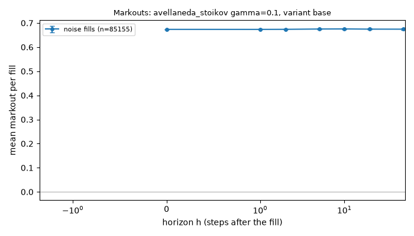
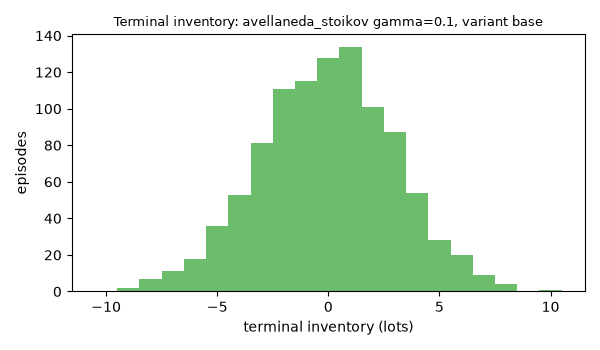
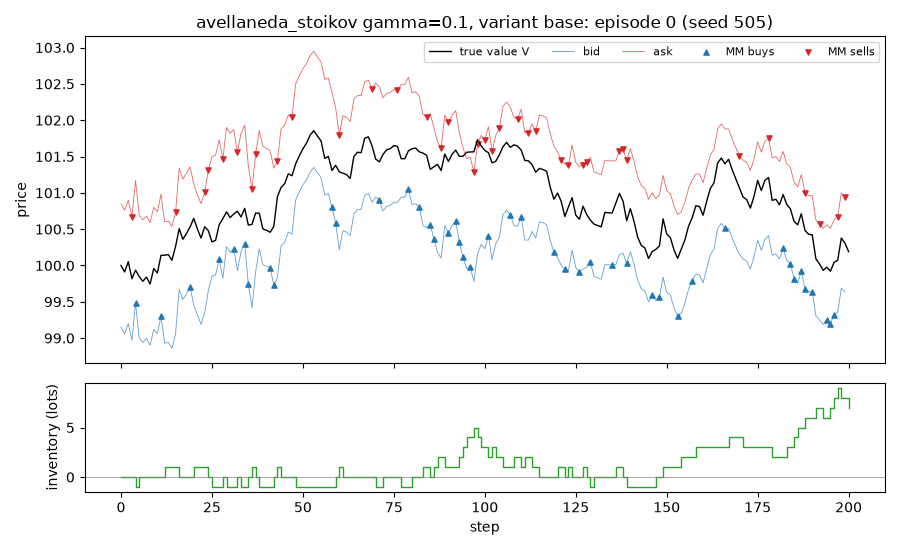

# EXP-005: Robustness: do the key conclusions keep their sign under other model assumptions?

## Limitations (read first)

Everything below is a statement about a **model**, not about real markets.

- Fill probability is an assumed exponential function of the quote's distance from the mid.
- Orders are one lot. There is no order book, no queue position and no competing market maker.
- The market maker sees the true value as a public mid price (in the `public_mid` world).
- Strategies that use the volatility `sigma` or the flow parameter `k` are given the true values.
- Informed traders' horizon and threshold are invented parameters, not calibrated to data.
- No hedging, no correlated instruments. Latency exists only through `requote_every`.
- Parameters are not calibrated to any market; P&L units are arbitrary.

Specific to this experiment: the variants change one model assumption at a time, with invented values. Keeping its sign under these variants does not make a conclusion true of real markets; flipping its sign shows that it depends on the assumption changed.

## Setup

- scenario: `baseline`, config hash `fbe6c4ea5f6c`
- run id `20261109T220045Z-da3d7c`, git commit `c119b9766964`
- root seed 505, 1000 episodes
- variants tried so far in this repository (lines in `experiments/trial_log.csv`): 172
- variants: `{"base": {}, "sigma_high": {"market.sigma": 4.0}, "k_high": {"flow.noise.k": 3.0}, "jumps": {"market.process": "jump_diffusion", "market.jump.intensity": 5.0, "market.jump.size": 1.0}}`
- other settings: `{"spread_factor": 3.0, "informed": {"flow.informed.intensity": 120.0, "flow.informed.horizon_steps": 50, "engine.q_max": 200}, "narrow_half_spread": 0.1, "inventory": {"engine.liq_half_spread": 0.5, "engine.liq_impact": 0.05}, "as_gamma": 0.1, "skew_kappa": 0.05, "latency": {"engine.q_max": 200}, "slow_requote": 5}`
- pre-registered as EXP-005, approved by delegation during an overnight run on 2026-11-09

## Results: estimate [95% CI] of each conclusion under each variant

| conclusion | expected sign | base | sigma_high | k_high | jumps | label |
|---|---|---|---|---|---|---|
| K1a: fixed at h* earns more than at h*/f (P&L difference) | positive | 21.985 [21.277, 22.693] | 21.525 [20.216, 22.834] | 10.554 [9.895, 11.213] | 23.091 [22.006, 24.176] | robust |
| K1b: fixed at h* earns more than at h*·f (P&L difference) | positive | 39.419 [38.588, 40.249] | 39.392 [37.947, 40.836] | 19.761 [19.036, 20.486] | 39.846 [38.674, 41.018] | robust |
| K2: narrow fixed spread against informed flow loses (mean P&L) | negative | -21.638 [-23.889, -19.386] | -68.481 [-72.994, -63.969] | -27.675 [-30.129, -25.220] | -48.912 [-52.536, -45.288] | robust |
| K3a: Avellaneda-Stoikov std below fixed at the same spread (std ratio - 1) | negative | -0.553 [-0.588, -0.513] | -0.687 [-0.712, -0.659] | -0.703 [-0.729, -0.674] | -0.647 [-0.672, -0.620] | robust |
| K3b: skew std below fixed at the same spread (std ratio - 1) | negative | -0.473 [-0.512, -0.430] | -0.550 [-0.584, -0.513] | -0.667 [-0.697, -0.633] | -0.543 [-0.572, -0.512] | robust |
| K4: slow requoting earns less than requoting every step (P&L difference) | negative | -2.620 [-3.080, -2.160] | -11.261 [-12.637, -9.884] | -5.552 [-6.234, -4.870] | -6.627 [-7.479, -5.774] | robust |

Best half-spread h* used in each variant: base 0.749, sigma_high 0.749, k_high 0.374, jumps 0.749.

`robust`: the CI is on the expected side of zero in every variant. `fragile`: in some variant the CI is entirely on the other side. `unresolved`: some CI includes zero.

## Representative grid point in detail: avellaneda_stoikov gamma=0.1, variant base

Strategy `avellaneda_stoikov {"gamma": 0.1}`, 1000 episodes. One grid point, shown so that the mechanics behind the table above are visible.

### P&L decomposition (mean per episode)

| part | mean | 95% CI |
|---|---|---|
| spread capture | 57.358 | [57.008, 57.708] |
| short-term move after fills (negative = adverse selection) | 0.154 | [-0.021, 0.328] |
| inventory / holding P&L | -0.023 | [-0.191, 0.145] |
| fees paid (subtracted) | 0.000 | [0.000, 0.000] |
| **total: mark-to-market P&L** | 57.489 | [57.092, 57.886] |

Decomposition horizon h = 10 steps. Identity check: the largest per-episode error of `spread + short-term + inventory - fees = P&L` is 2.70e-13.

### Markouts by counterparty (mean per fill)

| counterparty | fills | h | markout | 95% CI |
|---|---|---|---|---|
| noise | 85155 | 0 | 0.6736 | [0.6731, 0.6740] |
| noise | 85155 | 1 | 0.6735 | [0.6725, 0.6744] |
| noise | 85155 | 2 | 0.6738 | [0.6726, 0.6750] |
| noise | 85155 | 5 | 0.6750 | [0.6733, 0.6768] |
| noise | 85155 | 10 | 0.6754 | [0.6733, 0.6775] |
| noise | 85155 | 20 | 0.6745 | [0.6721, 0.6770] |
| noise | 85155 | 50 | 0.6744 | [0.6718, 0.6770] |

One episode is an illustration, not evidence.

## Verdict against the pre-registered hypothesis

- PASS: K1a is robust (fixed at h* earns more than at h*/f (P&L difference)): robust
- PASS: K1b is robust (fixed at h* earns more than at h*·f (P&L difference)): robust
- PASS: K2 is robust (narrow fixed spread against informed flow loses (mean P&L)): robust
- PASS: K3a is robust (Avellaneda-Stoikov std below fixed at the same spread (std ratio - 1)): robust
- PASS: K3b is robust (skew std below fixed at the same spread (std ratio - 1)): robust
- PASS: K4 is robust (slow requoting earns less than requoting every step (P&L difference)): robust

**CONFIRMED**

## What depends on the model's assumptions

- Every variant keeps the exponential fill intensity, one-lot orders and a single market maker. Those assumptions are not tested here.
- The variants are single changes; combinations are not explored.
