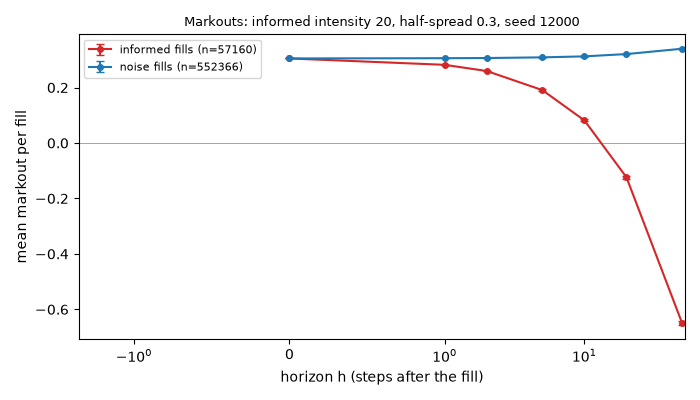
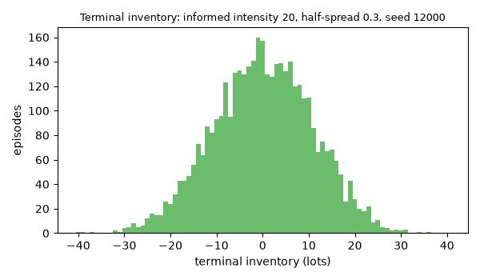
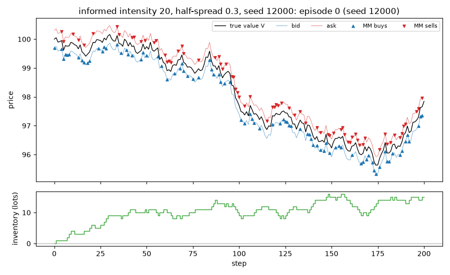

# EXP-006: Are the closed forms biased? A check on independent seeds

## Limitations (read first)

Everything below is a statement about a **model**, not about real markets.

- Fill probability is an assumed exponential function of the quote's distance from the mid.
- Orders are one lot. There is no order book, no queue position and no competing market maker.
- The market maker sees the true value as a public mid price (in the `public_mid` world).
- Strategies that use the volatility `sigma` or the flow parameter `k` are given the true values.
- Informed traders' horizon and threshold are invented parameters, not calibrated to data.
- No hedging, no correlated instruments. Latency exists only through `requote_every`.
- Parameters are not calibrated to any market; P&L units are arbitrary.

Specific to this experiment: it tests the simulator against its own closed forms. It says nothing about whether the model resembles a market.

## Setup

- scenario: `baseline`, config hash `fbe6c4ea5f6c`
- run id `20261110T055459Z-fb6728`, git commit `f4305a32555a`
- root seed 6000, 4000 episodes
- variants tried so far in this repository (lines in `experiments/trial_log.csv`): 172
- every cell has its own seed: `6000 + 1000 * cell index`, so the cells are independent
- settings `{"std_half_spreads": [0.4, 0.7, 0.85, 1.0, 1.25, 1.5], "informed": {"flow.informed.horizon_steps": 50, "engine.q_max": 200}, "mean_cells": [[20.0, 0.3], [40.0, 0.4], [80.0, 0.5], [120.0, 0.3], [160.0, 0.6], [200.0, 0.4]]}`
- pre-registered as EXP-006, approved by Nick on 2026-11-10

## Results

### Part A: std of P&L, noise flow only

| half-spread | seed | simulated std [95% CI] | theory | ratio | z |
|---|---|---|---|---|---|
| 0.4 | 6000 | 14.020 [13.459, 14.580] | 13.722 | 1.022 | 1.04 |
| 0.7 | 7000 | 12.891 [12.484, 13.319] | 13.028 | 0.989 | -0.64 |
| 0.85 | 8000 | 12.788 [12.412, 13.169] | 12.623 | 1.013 | 0.86 |
| 1 | 9000 | 12.092 [11.727, 12.463] | 12.189 | 0.992 | -0.51 |
| 1.25 | 10000 | 11.306 [10.987, 11.618] | 11.414 | 0.990 | -0.67 |
| 1.5 | 11000 | 10.536 [10.263, 10.807] | 10.593 | 0.995 | -0.41 |

Mean ratio 1.000; pooled z -0.14.

### Part B: mean P&L with informed flow

| informed intensity | half-spread | seed | simulated mean [95% CI] | theory | z |
|---|---|---|---|---|---|
| 20 | 0.3 | 12000 | 37.50 [37.02, 37.97] | 37.61 | -0.45 |
| 40 | 0.4 | 13000 | 39.97 [39.41, 40.54] | 40.33 | -1.24 |
| 80 | 0.5 | 14000 | 36.50 [35.63, 37.36] | 36.73 | -0.53 |
| 120 | 0.3 | 15000 | 7.02 [5.82, 8.21] | 7.32 | -0.50 |
| 160 | 0.6 | 16000 | 24.99 [23.43, 26.56] | 24.54 | 0.57 |
| 200 | 0.4 | 17000 | -4.41 [-6.38, -2.45] | -3.77 | -0.65 |

Pooled z -1.14. Largest share of steps at the inventory limit: 0.0000.

`z` = (simulated - theory) / standard error. The std's standard error comes from a bootstrap over episodes. `pooled z` = mean z times the square root of the number of cells: with independent cells it is standard normal if there is no bias.

## Representative grid point in detail: informed intensity 20, half-spread 0.3, seed 12000

Strategy `fixed {"half_spread": 0.3}`, 4000 episodes. One grid point, shown so that the mechanics behind the table above are visible.

### P&L decomposition (mean per episode)

| part | mean | 95% CI |
|---|---|---|
| spread capture | 46.470 | [46.379, 46.562] |
| short-term move after fills (negative = adverse selection) | -2.156 | [-2.290, -2.022] |
| inventory / holding P&L | -6.817 | [-7.260, -6.375] |
| fees paid (subtracted) | 0.000 | [0.000, 0.000] |
| **total: mark-to-market P&L** | 37.497 | [37.024, 37.970] |

Decomposition horizon h = 10 steps. Identity check: the largest per-episode error of `spread + short-term + inventory - fees = P&L` is 3.38e-12.

### Markouts by counterparty (mean per fill)

| counterparty | fills | h | markout | 95% CI |
|---|---|---|---|---|
| noise | 552366 | 0 | 0.3050 | [0.3050, 0.3050] |
| noise | 552366 | 1 | 0.3058 | [0.3055, 0.3061] |
| noise | 552366 | 2 | 0.3064 | [0.3060, 0.3069] |
| noise | 552366 | 5 | 0.3089 | [0.3082, 0.3096] |
| noise | 552366 | 10 | 0.3125 | [0.3115, 0.3134] |
| noise | 552366 | 20 | 0.3207 | [0.3194, 0.3221] |
| noise | 552366 | 50 | 0.3399 | [0.3379, 0.3420] |
| informed | 57160 | 0 | 0.3050 | [0.3049, 0.3050] |
| informed | 57160 | 1 | 0.2820 | [0.2808, 0.2831] |
| informed | 57160 | 2 | 0.2596 | [0.2580, 0.2612] |
| informed | 57160 | 5 | 0.1908 | [0.1883, 0.1933] |
| informed | 57160 | 10 | 0.0816 | [0.0781, 0.0852] |
| informed | 57160 | 20 | -0.1235 | [-0.1286, -0.1184] |
| informed | 57160 | 50 | -0.6490 | [-0.6571, -0.6409] |

One episode is an illustration, not evidence.

## Verdict against the pre-registered hypothesis

- PASS: A1 std: |z| <= 3 in every cell
- PASS: A2 std: pooled |z| <= 3 (no common bias)
- PASS: B1 mean with informed flow: |z| <= 3 in every cell
- PASS: B2 mean with informed flow: pooled |z| <= 3 (no common bias)

**CONFIRMED**

## What depends on the model's assumptions

- Both formulas assume an inventory limit that does not bind and requoting every step.
- The check covers the cells listed; a bias elsewhere on the grid is not excluded.
