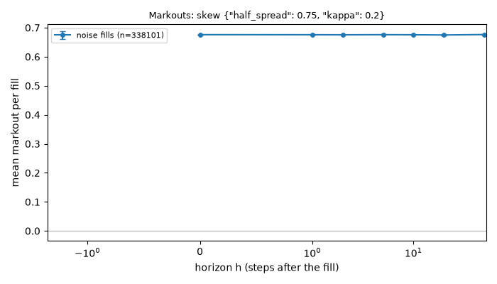
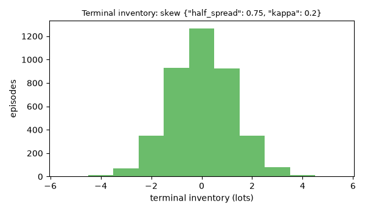
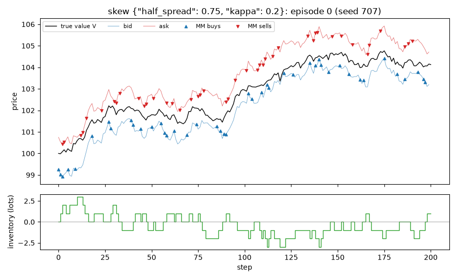

# EXP-007: Skew against Avellaneda-Stoikov, head to head on liquidated P&L

## Limitations (read first)

Everything below is a statement about a **model**, not about real markets.

- Fill probability is an assumed exponential function of the quote's distance from the mid.
- Orders are one lot. There is no order book, no queue position and no competing market maker.
- The market maker sees the true value as a public mid price (in the `public_mid` world).
- Strategies that use the volatility `sigma` or the flow parameter `k` are given the true values.
- Informed traders' horizon and threshold are invented parameters, not calibrated to data.
- No hedging, no correlated instruments. Latency exists only through `requote_every`.
- Parameters are not calibrated to any market; P&L units are arbitrary.

Specific to this experiment: noise traders only. The final inventory is closed at 0.5 + 0.05*|q| per lot (invented). Avellaneda-Stoikov is derived for mark-to-market wealth without that cost and is given the true sigma and k. One parameter setting of each strategy is compared, not the best of each.

## Setup

- scenario: `inventory`, config hash `462cf8b0d9ce`
- run id `20261110T055616Z-ecb1a6`, git commit `3596e05026ef`
- root seed 707, 4000 episodes
- variants tried so far in this repository (lines in `experiments/trial_log.csv`): 172
- A = `skew {"half_spread": 0.75, "kappa": 0.2}`, B = `avellaneda_stoikov {"gamma": 0.1}`, same seed (common random numbers)
- pre-registered as EXP-007, approved by Nick on 2026-11-10
- CE with risk aversion 0.1; std-ratio and CE intervals by paired bootstrap (2000 resamples)

## Results

| measure | A: mean [95% CI] | A: std | B: mean [95% CI] | B: std | mean A - B [95% CI] | std A / B [95% CI] | CE A - B [95% CI] |
|---|---|---|---|---|---|---|---|
| liquidated P&L | 56.59 [56.40, 56.77] | 6.05 | 55.60 [55.40, 55.80] | 6.40 | 0.98 [0.89, 1.08] | 0.946 [0.932, 0.961] | 1.22 [1.09, 1.33] |
| mark-to-market P&L | 57.14 [56.96, 57.33] | 6.06 | 57.24 [57.04, 57.44] | 6.33 | -0.10 [-0.19, -0.01] | 0.957 [0.944, 0.971] | 0.07 [-0.04, 0.18] |

Average quoted spread: A 1.510, B 1.502. Std of terminal inventory: A 1.27, B 3.02. Mean |inventory| during the episode: A 0.93, B 1.06.

The criteria are on liquidated P&L. The mark-to-market row is the objective Avellaneda-Stoikov is derived for; it is reported without a pre-registered prediction.

## Representative grid point in detail: skew {"half_spread": 0.75, "kappa": 0.2}

Strategy `skew {"half_spread": 0.75, "kappa": 0.2}`, 4000 episodes. One grid point, shown so that the mechanics behind the table above are visible.

### P&L decomposition (mean per episode)

| part | mean | 95% CI |
|---|---|---|
| spread capture | 57.133 | [56.960, 57.307] |
| short-term move after fills (negative = adverse selection) | -0.026 | [-0.117, 0.064] |
| inventory / holding P&L | 0.037 | [-0.040, 0.113] |
| fees paid (subtracted) | 0.000 | [0.000, 0.000] |
| **total: mark-to-market P&L** | 57.144 | [56.956, 57.332] |

Decomposition horizon h = 10 steps. Identity check: the largest per-episode error of `spread + short-term + inventory - fees = P&L` is 2.70e-13.

### Markouts by counterparty (mean per fill)

| counterparty | fills | h | markout | 95% CI |
|---|---|---|---|---|
| noise | 338101 | 0 | 0.6759 | [0.6757, 0.6761] |
| noise | 338101 | 1 | 0.6757 | [0.6753, 0.6762] |
| noise | 338101 | 2 | 0.6755 | [0.6749, 0.6761] |
| noise | 338101 | 5 | 0.6759 | [0.6750, 0.6768] |
| noise | 338101 | 10 | 0.6756 | [0.6745, 0.6767] |
| noise | 338101 | 20 | 0.6749 | [0.6737, 0.6761] |
| noise | 338101 | 50 | 0.6763 | [0.6751, 0.6775] |

One episode is an illustration, not evidence.

## Verdict against the pre-registered hypothesis

- PASS: H1 A has a higher mean liquidated P&L than B (paired CI above 0)
- PASS: H2 A's std of liquidated P&L is not above B's (ratio CI upper end below 1)

**CONFIRMED**

## What depends on the model's assumptions

- A martingale value and noise-only flow: leaning toward the mid is never exploited.
- The liquidation cost decides how much terminal inventory matters.
- One (gamma, kappa) pair. Another pair can order the two strategies differently.
