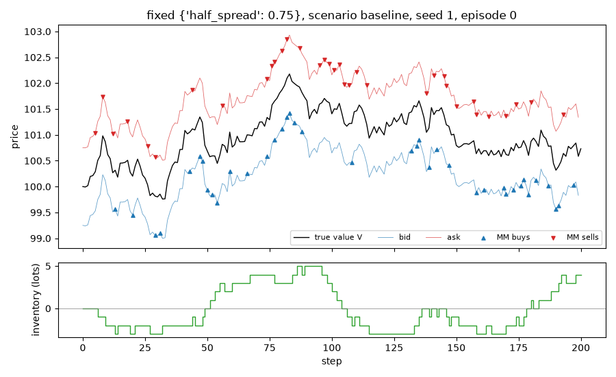

# Run report: `fixed` in scenario `baseline`

## Limitations (read first)

Everything below is a statement about a **model**, not about real markets.

- Fill probability is an assumed exponential function of the quote's distance from the mid.
- Orders are one lot. There is no order book, no queue position and no competing market maker.
- The market maker sees the true value as a public mid price (in the `public_mid` world).
- Strategies that use the volatility `sigma` or the flow parameter `k` are given the true values.
- Informed traders' horizon and threshold are invented parameters, not calibrated to data.
- No hedging, no correlated instruments. Latency exists only through `requote_every`.
- Parameters are not calibrated to any market; P&L units are arbitrary.

## Setup

- scenario: `baseline`, config hash `98f30782c37f`
- run id `20261109T210520Z-9e7c2f`, git commit `067bb5c7b737`
- root seed 1, 1000 episodes
- variants tried so far in this repository (lines in `experiments/trial_log.csv`): 1
- strategy `fixed`, parameters `{"half_spread": 0.75}`
- 200 steps of dt = 0.005 per episode, decomposition horizon h = 10 steps

## Results (per episode)

| P&L | mean | 95% CI | std | Sharpe (per episode, not annualised) | 5% quantile | ES 5% | P(P&L<0) | CE (CARA) |
|---|---|---|---|---|---|---|---|---|
| mark-to-market | 60.717 | [59.917, 61.516] | 12.885 | 4.712 | 40.344 | 33.053 | 0.000 | 50.753 |
| liquidated | 60.717 | [59.917, 61.516] | 12.885 | 4.712 | 40.344 | 33.053 | 0.000 | 50.753 |

CE uses risk aversion gamma = 0.1.

## P&L decomposition (mean per episode)

| part | mean | 95% CI |
|---|---|---|
| spread capture | 60.825 | [60.431, 61.220] |
| short-term move after fills (negative = adverse selection) | -0.075 | [-0.297, 0.146] |
| inventory / holding P&L | -0.033 | [-0.728, 0.661] |
| fees paid (subtracted) | 0.000 | [0.000, 0.000] |
| **total: mark-to-market P&L** | 60.717 | [59.917, 61.516] |

Identity check: the largest per-episode error of `spread + short-term + inventory - fees = P&L` is 1.76e-12.

## Activity (mean per episode)

| metric | mean | 95% CI |
|---|---|---|
| buys | 40.306 | [39.942, 40.670] |
| sells | 40.261 | [39.893, 40.629] |
| volume | 80.567 | [80.045, 81.089] |
| max_abs_q | 9.666 | [9.390, 9.942] |
| mean_abs_q | 4.346 | [4.181, 4.511] |
| terminal_q | 0.045 | [-0.469, 0.559] |
| share_at_limit | 0.000 | [0.000, 0.000] |

## Example episode

Episode 0 of this run. One episode is an illustration, not evidence.

## Files

`summary.json` (all numbers above), `episodes.csv` (one row per episode).
