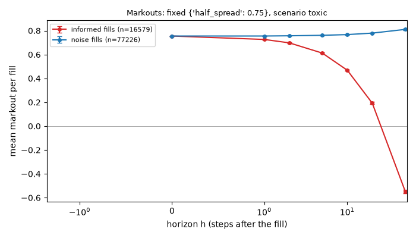
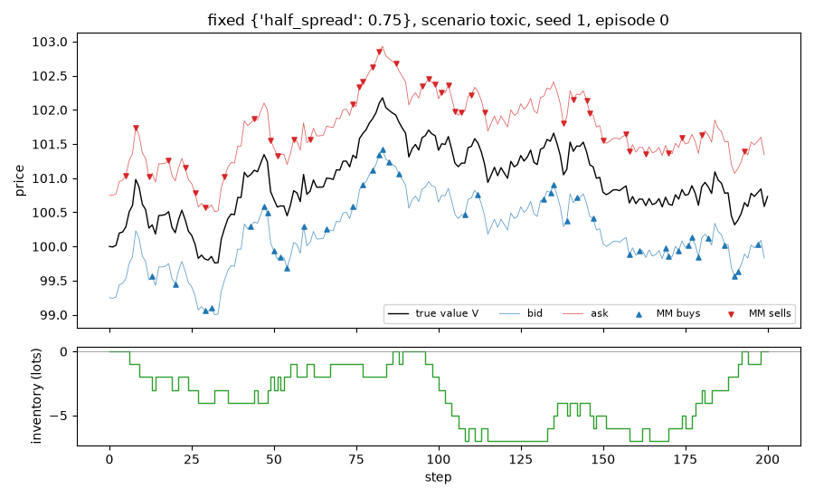

# Run report: `fixed` in scenario `toxic`

## Limitations (read first)

Everything below is a statement about a **model**, not about real markets.

- Fill probability is an assumed exponential function of the quote's distance from the mid.
- Orders are one lot. There is no order book, no queue position and no competing market maker.
- The market maker sees the true value as a public mid price (in the `public_mid` world).
- Strategies that use the volatility `sigma` or the flow parameter `k` are given the true values.
- Informed traders' horizon and threshold are invented parameters, not calibrated to data.
- No hedging, no correlated instruments. Latency exists only through `requote_every`.
- Parameters are not calibrated to any market; P&L units are arbitrary.

## Setup

- scenario: `toxic`, config hash `92ddd4ad4197`
- run id `20261109T213238Z-a03205`, git commit `cf39d19836df`
- root seed 1, 1000 episodes
- variants tried so far in this repository (lines in `experiments/trial_log.csv`): 12
- strategy `fixed`, parameters `{"half_spread": 0.75}`
- 200 steps of dt = 0.005 per episode, decomposition horizon h = 50 steps

## Results (per episode)

| P&L | mean | 95% CI | std | Sharpe (per episode, not annualised) | 5% quantile | ES 5% | P(P&L<0) | CE (CARA) |
|---|---|---|---|---|---|---|---|---|
| mark-to-market | 53.817 | [52.747, 54.887] | 17.245 | 3.121 | 20.273 | 3.984 | 0.011 | 20.484 |
| liquidated | 53.817 | [52.747, 54.887] | 17.245 | 3.121 | 20.273 | 3.984 | 0.011 | 20.484 |

CE uses risk aversion gamma = 0.1.

## P&L decomposition (mean per episode)

| part | mean | 95% CI |
|---|---|---|
| spread capture | 70.819 | [70.350, 71.289] |
| short-term move after fills (negative = adverse selection) | -17.322 | [-18.032, -16.613] |
| inventory / holding P&L | 0.320 | [-0.479, 1.119] |
| fees paid (subtracted) | 0.000 | [0.000, 0.000] |
| **total: mark-to-market P&L** | 53.817 | [52.747, 54.887] |

Identity check: the largest per-episode error of `spread + short-term + inventory - fees = P&L` is 2.81e-12.

## Activity (mean per episode)

| metric | mean | 95% CI |
|---|---|---|
| buys | 47.145 | [46.643, 47.647] |
| sells | 46.660 | [46.166, 47.154] |
| volume | 93.805 | [93.183, 94.427] |
| max_abs_q | 13.897 | [13.481, 14.313] |
| mean_abs_q | 6.641 | [6.390, 6.893] |
| terminal_q | 0.485 | [-0.293, 1.263] |
| share_at_limit | 0.000 | [0.000, 0.000] |

## Markouts by counterparty (mean per fill)

Markout at horizon h = side * (V at h steps after the fill - fill price). At h = 0 it is the edge at the fill; a curve that falls with h means the flow was informed. The market maker cannot see the counterparty type; the analysis can.

| counterparty | fills | h | markout | 95% CI |
|---|---|---|---|---|
| noise | 77226 | 0 | 0.7550 | [0.7549, 0.7550] |
| noise | 77226 | 1 | 0.7551 | [0.7542, 0.7560] |
| noise | 77226 | 2 | 0.7570 | [0.7557, 0.7583] |
| noise | 77226 | 5 | 0.7609 | [0.7588, 0.7630] |
| noise | 77226 | 10 | 0.7671 | [0.7642, 0.7699] |
| noise | 77226 | 20 | 0.7794 | [0.7755, 0.7834] |
| noise | 77226 | 50 | 0.8106 | [0.8046, 0.8166] |
| informed | 16579 | 0 | 0.7549 | [0.7549, 0.7550] |
| informed | 16579 | 1 | 0.7263 | [0.7243, 0.7283] |
| informed | 16579 | 2 | 0.6977 | [0.6948, 0.7006] |
| informed | 16579 | 5 | 0.6120 | [0.6072, 0.6168] |
| informed | 16579 | 10 | 0.4683 | [0.4614, 0.4751] |
| informed | 16579 | 20 | 0.1921 | [0.1822, 0.2021] |
| informed | 16579 | 50 | -0.5491 | [-0.5648, -0.5333] |

## Example episode

Episode 0 of this run. One episode is an illustration, not evidence.

## Files

`summary.json` (all numbers above), `episodes.csv` (one row per episode).
