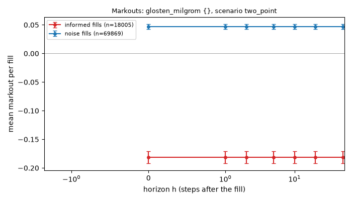
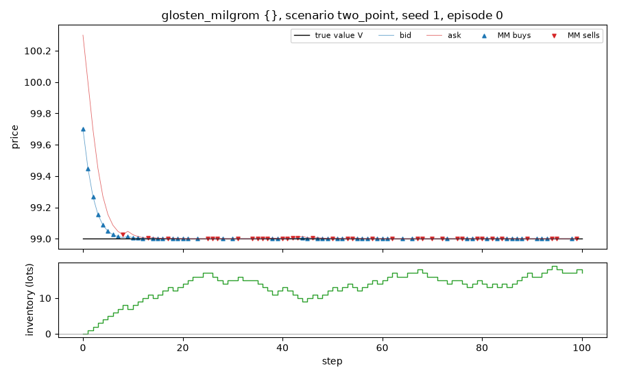

# Run report: `glosten_milgrom` in scenario `two_point`

## Limitations (read first)

Everything below is a statement about a **model**, not about real markets.

- Fill probability is an assumed exponential function of the quote's distance from the mid.
- Orders are one lot. There is no order book, no queue position and no competing market maker.
- The market maker sees the true value as a public mid price (in the `public_mid` world).
- Strategies that use the volatility `sigma` or the flow parameter `k` are given the true values.
- Informed traders' horizon and threshold are invented parameters, not calibrated to data.
- No hedging, no correlated instruments. Latency exists only through `requote_every`.
- Parameters are not calibrated to any market; P&L units are arbitrary.

## Setup

- scenario: `two_point`, config hash `ec7328416b85`
- run id `20261109T213242Z-bc36a7`, git commit `cf39d19836df` (uncommitted changes)
- root seed 1, 1000 episodes
- variants tried so far in this repository (lines in `experiments/trial_log.csv`): 13
- strategy `glosten_milgrom`, parameters `{}`
- 100 steps of dt = 0.005 per episode, decomposition horizon h = 10 steps

## Results (per episode)

| P&L | mean | 95% CI | std | Sharpe (per episode, not annualised) | 5% quantile | ES 5% | P(P&L<0) | CE (CARA) |
|---|---|---|---|---|---|---|---|---|
| mark-to-market | 0.015 | [-0.084, 0.114] | 1.599 | 0.009 | -1.646 | -1.708 | 0.622 | -0.102 |
| liquidated | 0.015 | [-0.084, 0.114] | 1.599 | 0.009 | -1.646 | -1.708 | 0.622 | -0.102 |

CE uses risk aversion gamma = 0.1.

## P&L decomposition (mean per episode)

| part | mean | 95% CI |
|---|---|---|
| spread capture | 0.015 | [-0.084, 0.114] |
| short-term move after fills (negative = adverse selection) | 0.000 | [0.000, 0.000] |
| inventory / holding P&L | 0.000 | [0.000, 0.000] |
| fees paid (subtracted) | 0.000 | [0.000, 0.000] |
| **total: mark-to-market P&L** | 0.015 | [-0.084, 0.114] |

Identity check: the largest per-episode error of `spread + short-term + inventory - fees = P&L` is 3.98e-12.

## Activity (mean per episode)

| metric | mean | 95% CI |
|---|---|---|
| buys | 43.924 | [43.315, 44.533] |
| sells | 43.950 | [43.345, 44.555] |
| volume | 87.874 | [87.460, 88.288] |
| max_abs_q | 20.220 | [19.976, 20.464] |
| mean_abs_q | 11.668 | [11.484, 11.852] |
| terminal_q | -0.026 | [-1.167, 1.115] |
| share_at_limit | 0.000 | [0.000, 0.000] |

## Markouts by counterparty (mean per fill)

Markout at horizon h = side * (V at h steps after the fill - fill price). At h = 0 it is the edge at the fill; a curve that falls with h means the flow was informed. The market maker cannot see the counterparty type; the analysis can.

| counterparty | fills | h | markout | 95% CI |
|---|---|---|---|---|
| noise | 69869 | 0 | 0.0469 | [0.0427, 0.0511] |
| noise | 69869 | 1 | 0.0469 | [0.0427, 0.0511] |
| noise | 69869 | 2 | 0.0469 | [0.0427, 0.0511] |
| noise | 69869 | 5 | 0.0469 | [0.0427, 0.0511] |
| noise | 69869 | 10 | 0.0469 | [0.0427, 0.0511] |
| noise | 69869 | 20 | 0.0469 | [0.0427, 0.0511] |
| noise | 69869 | 50 | 0.0469 | [0.0427, 0.0511] |
| informed | 18005 | 0 | -0.1813 | [-0.1921, -0.1706] |
| informed | 18005 | 1 | -0.1813 | [-0.1921, -0.1706] |
| informed | 18005 | 2 | -0.1813 | [-0.1921, -0.1706] |
| informed | 18005 | 5 | -0.1813 | [-0.1921, -0.1706] |
| informed | 18005 | 10 | -0.1813 | [-0.1921, -0.1706] |
| informed | 18005 | 20 | -0.1813 | [-0.1921, -0.1706] |
| informed | 18005 | 50 | -0.1813 | [-0.1921, -0.1706] |

## Example episode

Episode 0 of this run. One episode is an illustration, not evidence.

## Files

`summary.json` (all numbers above), `episodes.csv` (one row per episode).
