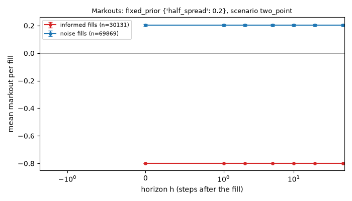
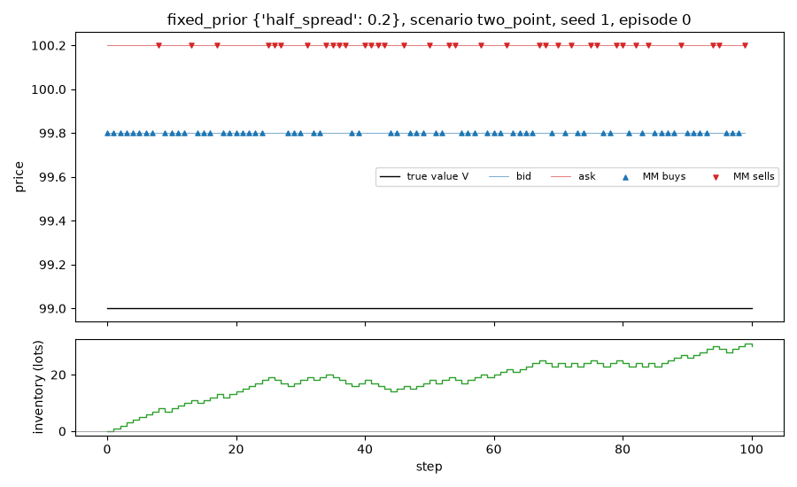

# Run report: `fixed_prior` in scenario `two_point`

## Limitations (read first)

Everything below is a statement about a **model**, not about real markets.

- Fill probability is an assumed exponential function of the quote's distance from the mid.
- Orders are one lot. There is no order book, no queue position and no competing market maker.
- The market maker sees the true value as a public mid price (in the `public_mid` world).
- Strategies that use the volatility `sigma` or the flow parameter `k` are given the true values.
- Informed traders' horizon and threshold are invented parameters, not calibrated to data.
- No hedging, no correlated instruments. Latency exists only through `requote_every`.
- Parameters are not calibrated to any market; P&L units are arbitrary.

## Setup

- scenario: `two_point`, config hash `ec7328416b85`
- run id `20261109T213246Z-6c1ca4`, git commit `cf39d19836df` (uncommitted changes)
- root seed 1, 1000 episodes
- variants tried so far in this repository (lines in `experiments/trial_log.csv`): 14
- strategy `fixed_prior`, parameters `{"half_spread": 0.2}`
- 100 steps of dt = 0.005 per episode, decomposition horizon h = 10 steps

## Results (per episode)

| P&L | mean | 95% CI | std | Sharpe (per episode, not annualised) | 5% quantile | ES 5% | P(P&L<0) | CE (CARA) |
|---|---|---|---|---|---|---|---|---|
| mark-to-market | -9.946 | [-10.545, -9.347] | 9.653 | -1.030 | -26.000 | -29.077 | 0.821 | -14.424 |
| liquidated | -9.946 | [-10.545, -9.347] | 9.653 | -1.030 | -26.000 | -29.077 | 0.821 | -14.424 |

CE uses risk aversion gamma = 0.1.

## P&L decomposition (mean per episode)

| part | mean | 95% CI |
|---|---|---|
| spread capture | -9.946 | [-10.545, -9.347] |
| short-term move after fills (negative = adverse selection) | 0.000 | [0.000, 0.000] |
| inventory / holding P&L | 0.000 | [0.000, 0.000] |
| fees paid (subtracted) | 0.000 | [0.000, 0.000] |
| **total: mark-to-market P&L** | -9.946 | [-10.545, -9.347] |

Identity check: the largest per-episode error of `spread + short-term + inventory - fees = P&L` is 1.35e-11.

## Activity (mean per episode)

| metric | mean | 95% CI |
|---|---|---|
| buys | 49.953 | [48.976, 50.930] |
| sells | 50.047 | [49.070, 51.024] |
| volume | 100.000 | [100.000, 100.000] |
| max_abs_q | 31.054 | [30.485, 31.623] |
| mean_abs_q | 15.168 | [14.840, 15.495] |
| terminal_q | -0.094 | [-2.047, 1.859] |
| share_at_limit | 0.000 | [0.000, 0.000] |

## Markouts by counterparty (mean per fill)

Markout at horizon h = side * (V at h steps after the fill - fill price). At h = 0 it is the edge at the fill; a curve that falls with h means the flow was informed. The market maker cannot see the counterparty type; the analysis can.

| counterparty | fills | h | markout | 95% CI |
|---|---|---|---|---|
| noise | 69869 | 0 | 0.2026 | [0.1952, 0.2101] |
| noise | 69869 | 1 | 0.2026 | [0.1952, 0.2101] |
| noise | 69869 | 2 | 0.2026 | [0.1952, 0.2101] |
| noise | 69869 | 5 | 0.2026 | [0.1952, 0.2101] |
| noise | 69869 | 10 | 0.2026 | [0.1952, 0.2101] |
| noise | 69869 | 20 | 0.2026 | [0.1952, 0.2101] |
| noise | 69869 | 50 | 0.2026 | [0.1952, 0.2101] |
| informed | 30131 | 0 | -0.8000 | [-0.8000, -0.8000] |
| informed | 30131 | 1 | -0.8000 | [-0.8000, -0.8000] |
| informed | 30131 | 2 | -0.8000 | [-0.8000, -0.8000] |
| informed | 30131 | 5 | -0.8000 | [-0.8000, -0.8000] |
| informed | 30131 | 10 | -0.8000 | [-0.8000, -0.8000] |
| informed | 30131 | 20 | -0.8000 | [-0.8000, -0.8000] |
| informed | 30131 | 50 | -0.8000 | [-0.8000, -0.8000] |

## Example episode

Episode 0 of this run. One episode is an illustration, not evidence.

## Files

`summary.json` (all numbers above), `episodes.csv` (one row per episode).
