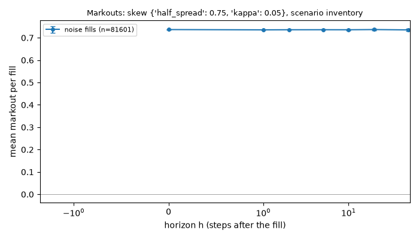
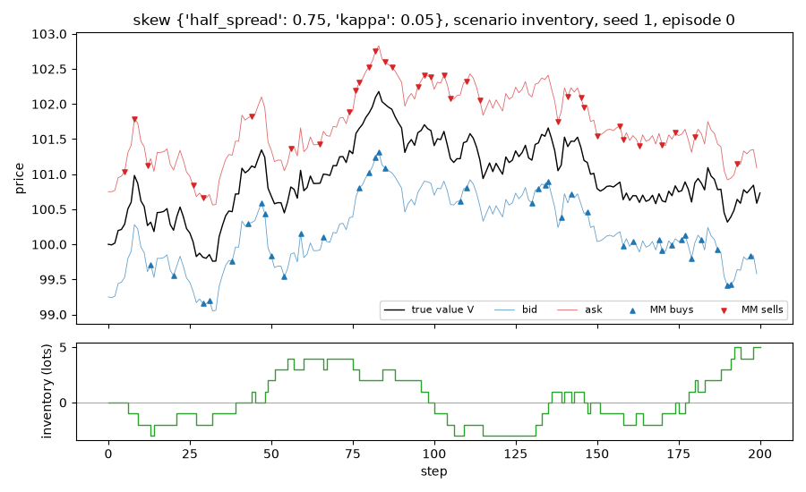

# Run report: `skew` in scenario `inventory`

## Limitations (read first)

Everything below is a statement about a **model**, not about real markets.

- Fill probability is an assumed exponential function of the quote's distance from the mid.
- Orders are one lot. There is no order book, no queue position and no competing market maker.
- The market maker sees the true value as a public mid price (in the `public_mid` world).
- Strategies that use the volatility `sigma` or the flow parameter `k` are given the true values.
- Informed traders' horizon and threshold are invented parameters, not calibrated to data.
- No hedging, no correlated instruments. Latency exists only through `requote_every`.
- Parameters are not calibrated to any market; P&L units are arbitrary.

## Setup

- scenario: `inventory`, config hash `462cf8b0d9ce`
- run id `20261109T214827Z-61dfe1`, git commit `f6443b837a70`
- root seed 1, 1000 episodes
- variants tried so far in this repository (lines in `experiments/trial_log.csv`): 113
- strategy `skew`, parameters `{"half_spread": 0.75, "kappa": 0.05}`
- 200 steps of dt = 0.005 per episode, decomposition horizon h = 10 steps

## Results (per episode)

| P&L | mean | 95% CI | std | Sharpe (per episode, not annualised) | 5% quantile | ES 5% | P(P&L<0) | CE (CARA) |
|---|---|---|---|---|---|---|---|---|
| mark-to-market | 60.019 | [59.554, 60.484] | 7.496 | 8.006 | 47.624 | 44.319 | 0.000 | 57.185 |
| liquidated | 58.771 | [58.307, 59.236] | 7.480 | 7.857 | 46.486 | 42.874 | 0.000 | 55.919 |

CE uses risk aversion gamma = 0.1.

## P&L decomposition (mean per episode)

| part | mean | 95% CI |
|---|---|---|
| spread capture | 60.116 | [59.732, 60.499] |
| short-term move after fills (negative = adverse selection) | -0.070 | [-0.283, 0.143] |
| inventory / holding P&L | -0.027 | [-0.312, 0.259] |
| fees paid (subtracted) | 0.000 | [0.000, 0.000] |
| **total: mark-to-market P&L** | 60.019 | [59.554, 60.484] |

Identity check: the largest per-episode error of `spread + short-term + inventory - fees = P&L` is 5.12e-13.

## Activity (mean per episode)

| metric | mean | 95% CI |
|---|---|---|
| buys | 40.755 | [40.486, 41.024] |
| sells | 40.846 | [40.577, 41.115] |
| volume | 81.601 | [81.084, 82.118] |
| max_abs_q | 5.185 | [5.101, 5.269] |
| mean_abs_q | 1.820 | [1.784, 1.855] |
| terminal_q | -0.091 | [-0.241, 0.059] |
| share_at_limit | 0.000 | [0.000, 0.000] |

## Markouts by counterparty (mean per fill)

Markout at horizon h = side * (V at h steps after the fill - fill price). At h = 0 it is the edge at the fill; a curve that falls with h means the flow was informed. The market maker cannot see the counterparty type; the analysis can.

| counterparty | fills | h | markout | 95% CI |
|---|---|---|---|---|
| noise | 81601 | 0 | 0.7367 | [0.7365, 0.7369] |
| noise | 81601 | 1 | 0.7355 | [0.7345, 0.7364] |
| noise | 81601 | 2 | 0.7359 | [0.7346, 0.7371] |
| noise | 81601 | 5 | 0.7360 | [0.7341, 0.7379] |
| noise | 81601 | 10 | 0.7358 | [0.7332, 0.7385] |
| noise | 81601 | 20 | 0.7368 | [0.7333, 0.7402] |
| noise | 81601 | 50 | 0.7352 | [0.7311, 0.7394] |

## Example episode

Episode 0 of this run. One episode is an illustration, not evidence.

## Files

`summary.json` (all numbers above), `episodes.csv` (one row per episode).
