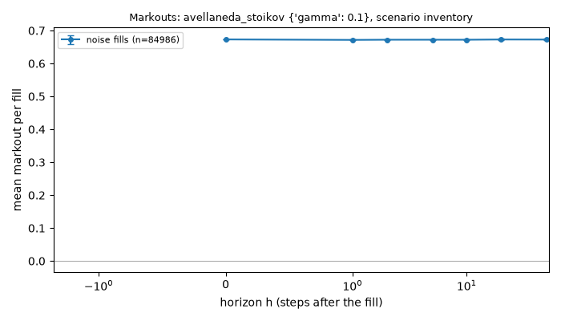
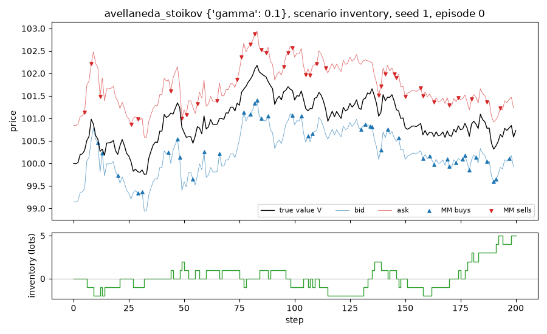

# Run report: `avellaneda_stoikov` in scenario `inventory`

## Limitations (read first)

Everything below is a statement about a **model**, not about real markets.

- Fill probability is an assumed exponential function of the quote's distance from the mid.
- Orders are one lot. There is no order book, no queue position and no competing market maker.
- The market maker sees the true value as a public mid price (in the `public_mid` world).
- Strategies that use the volatility `sigma` or the flow parameter `k` are given the true values.
- Informed traders' horizon and threshold are invented parameters, not calibrated to data.
- No hedging, no correlated instruments. Latency exists only through `requote_every`.
- Parameters are not calibrated to any market; P&L units are arbitrary.

## Setup

- scenario: `inventory`, config hash `462cf8b0d9ce`
- run id `20261109T214831Z-fa6890`, git commit `f6443b837a70` (uncommitted changes)
- root seed 1, 1000 episodes
- variants tried so far in this repository (lines in `experiments/trial_log.csv`): 114
- strategy `avellaneda_stoikov`, parameters `{"gamma": 0.1}`
- 200 steps of dt = 0.005 per episode, decomposition horizon h = 10 steps

## Results (per episode)

| P&L | mean | 95% CI | std | Sharpe (per episode, not annualised) | 5% quantile | ES 5% | P(P&L<0) | CE (CARA) |
|---|---|---|---|---|---|---|---|---|
| mark-to-market | 57.219 | [56.816, 57.623] | 6.496 | 8.809 | 46.309 | 43.556 | 0.000 | 55.116 |
| liquidated | 55.623 | [55.216, 56.029] | 6.553 | 8.488 | 44.528 | 41.633 | 0.000 | 53.465 |

CE uses risk aversion gamma = 0.1.

## P&L decomposition (mean per episode)

| part | mean | 95% CI |
|---|---|---|
| spread capture | 57.207 | [56.846, 57.568] |
| short-term move after fills (negative = adverse selection) | -0.078 | [-0.261, 0.105] |
| inventory / holding P&L | 0.091 | [-0.077, 0.259] |
| fees paid (subtracted) | 0.000 | [0.000, 0.000] |
| **total: mark-to-market P&L** | 57.219 | [56.816, 57.623] |

Identity check: the largest per-episode error of `spread + short-term + inventory - fees = P&L` is 3.41e-13.

## Activity (mean per episode)

| metric | mean | 95% CI |
|---|---|---|
| buys | 42.458 | [42.180, 42.736] |
| sells | 42.528 | [42.249, 42.807] |
| volume | 84.986 | [84.460, 85.512] |
| max_abs_q | 4.053 | [3.975, 4.131] |
| mean_abs_q | 1.065 | [1.050, 1.080] |
| terminal_q | -0.070 | [-0.252, 0.112] |
| share_at_limit | 0.000 | [0.000, 0.000] |

## Markouts by counterparty (mean per fill)

Markout at horizon h = side * (V at h steps after the fill - fill price). At h = 0 it is the edge at the fill; a curve that falls with h means the flow was informed. The market maker cannot see the counterparty type; the analysis can.

| counterparty | fills | h | markout | 95% CI |
|---|---|---|---|---|
| noise | 84986 | 0 | 0.6731 | [0.6727, 0.6735] |
| noise | 84986 | 1 | 0.6717 | [0.6707, 0.6727] |
| noise | 84986 | 2 | 0.6722 | [0.6710, 0.6735] |
| noise | 84986 | 5 | 0.6723 | [0.6704, 0.6741] |
| noise | 84986 | 10 | 0.6722 | [0.6700, 0.6744] |
| noise | 84986 | 20 | 0.6729 | [0.6704, 0.6755] |
| noise | 84986 | 50 | 0.6728 | [0.6701, 0.6754] |

## Example episode

Episode 0 of this run. One episode is an illustration, not evidence.

## Files

`summary.json` (all numbers above), `episodes.csv` (one row per episode).
