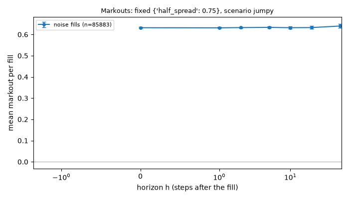
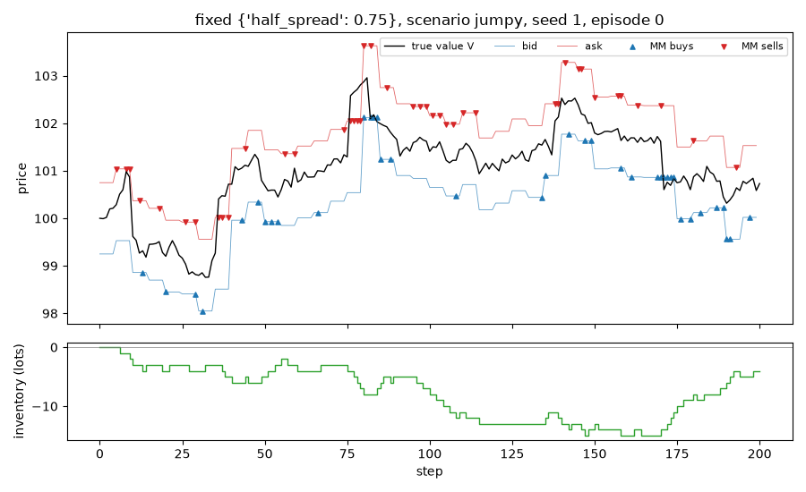

# Run report: `fixed` in scenario `jumpy`

## Limitations (read first)

Everything below is a statement about a **model**, not about real markets.

- Fill probability is an assumed exponential function of the quote's distance from the mid.
- Orders are one lot. There is no order book, no queue position and no competing market maker.
- The market maker sees the true value as a public mid price (in the `public_mid` world).
- Strategies that use the volatility `sigma` or the flow parameter `k` are given the true values.
- Informed traders' horizon and threshold are invented parameters, not calibrated to data.
- No hedging, no correlated instruments. Latency exists only through `requote_every`.
- Parameters are not calibrated to any market; P&L units are arbitrary.

## Setup

- scenario: `jumpy`, config hash `d1c8fe6df97e`
- run id `20261109T214839Z-19ae70`, git commit `f6443b837a70` (uncommitted changes)
- root seed 1, 1000 episodes
- variants tried so far in this repository (lines in `experiments/trial_log.csv`): 116
- strategy `fixed`, parameters `{"half_spread": 0.75}`
- 200 steps of dt = 0.005 per episode, decomposition horizon h = 10 steps

## Results (per episode)

| P&L | mean | 95% CI | std | Sharpe (per episode, not annualised) | 5% quantile | ES 5% | P(P&L<0) | CE (CARA) |
|---|---|---|---|---|---|---|---|---|
| mark-to-market | 55.096 | [53.842, 56.351] | 20.221 | 2.725 | 18.189 | 0.979 | 0.015 | -6.376 |
| liquidated | 55.096 | [53.842, 56.351] | 20.221 | 2.725 | 18.189 | 0.979 | 0.015 | -6.376 |

CE uses risk aversion gamma = 0.1.

## P&L decomposition (mean per episode)

| part | mean | 95% CI |
|---|---|---|
| spread capture | 54.269 | [53.861, 54.678] |
| short-term move after fills (negative = adverse selection) | 0.013 | [-0.361, 0.387] |
| inventory / holding P&L | 0.814 | [-0.356, 1.984] |
| fees paid (subtracted) | 0.000 | [0.000, 0.000] |
| **total: mark-to-market P&L** | 55.096 | [53.842, 56.351] |

Identity check: the largest per-episode error of `spread + short-term + inventory - fees = P&L` is 3.48e-12.

## Activity (mean per episode)

| metric | mean | 95% CI |
|---|---|---|
| buys | 42.937 | [42.562, 43.312] |
| sells | 42.946 | [42.552, 43.340] |
| volume | 85.883 | [85.358, 86.408] |
| max_abs_q | 10.755 | [10.461, 11.049] |
| mean_abs_q | 4.776 | [4.602, 4.950] |
| terminal_q | -0.009 | [-0.571, 0.553] |
| share_at_limit | 0.000 | [0.000, 0.000] |

## Markouts by counterparty (mean per fill)

Markout at horizon h = side * (V at h steps after the fill - fill price). At h = 0 it is the edge at the fill; a curve that falls with h means the flow was informed. The market maker cannot see the counterparty type; the analysis can.

| counterparty | fills | h | markout | 95% CI |
|---|---|---|---|---|
| noise | 85883 | 0 | 0.6319 | [0.6289, 0.6349] |
| noise | 85883 | 1 | 0.6314 | [0.6280, 0.6347] |
| noise | 85883 | 2 | 0.6326 | [0.6289, 0.6362] |
| noise | 85883 | 5 | 0.6336 | [0.6291, 0.6380] |
| noise | 85883 | 10 | 0.6321 | [0.6267, 0.6374] |
| noise | 85883 | 20 | 0.6326 | [0.6256, 0.6396] |
| noise | 85883 | 50 | 0.6398 | [0.6302, 0.6495] |

## Example episode

Episode 0 of this run. One episode is an illustration, not evidence.

## Files

`summary.json` (all numbers above), `episodes.csv` (one row per episode).
