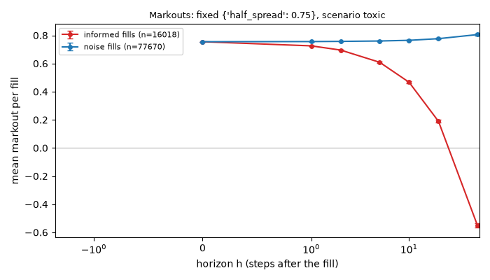
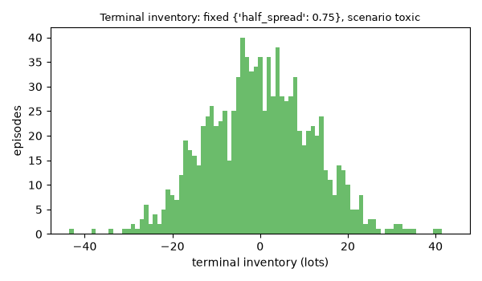
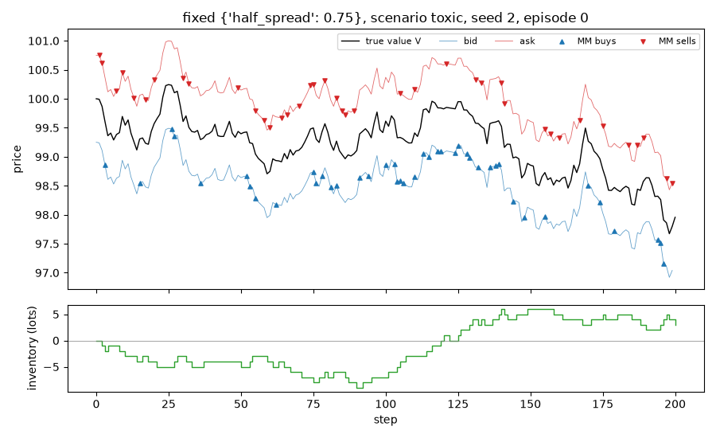

# Run report: `fixed` in scenario `toxic`

## Limitations (read first)

Everything below is a statement about a **model**, not about real markets.

- Fill probability is an assumed exponential function of the quote's distance from the mid.
- Orders are one lot. There is no order book, no queue position and no competing market maker.
- The market maker sees the true value as a public mid price (in the `public_mid` world).
- Strategies that use the volatility `sigma` or the flow parameter `k` are given the true values.
- Informed traders' horizon and threshold are invented parameters, not calibrated to data.
- No hedging, no correlated instruments. Latency exists only through `requote_every`.
- Parameters are not calibrated to any market; P&L units are arbitrary.

## Setup

- scenario: `toxic`, config hash `ebc690a89178`
- run id `20261109T220319Z-48d238`, git commit `d4003da403b0`
- root seed 2, 1000 episodes
- variants tried so far in this repository (lines in `experiments/trial_log.csv`): 157
- strategy `fixed`, parameters `{"half_spread": 0.75}`
- 200 steps of dt = 0.005 per episode

## Results (per episode)

| P&L | mean | 95% CI | std | Sharpe (per episode, not annualised) | 5% quantile | ES 5% | P(P&L<0) | CE (CARA) |
|---|---|---|---|---|---|---|---|---|
| mark-to-market | 54.674 | [53.608, 55.739] | 17.171 | 3.184 | 22.883 | 6.125 | 0.012 | -3.352 |
| liquidated | 54.674 | [53.608, 55.739] | 17.171 | 3.184 | 22.883 | 6.125 | 0.012 | -3.352 |

CE uses risk aversion gamma = 0.1.

## P&L decomposition (mean per episode)

| part | mean | 95% CI |
|---|---|---|
| spread capture | 70.731 | [70.273, 71.188] |
| short-term move after fills (negative = adverse selection) | -16.969 | [-17.708, -16.230] |
| inventory / holding P&L | 0.912 | [0.123, 1.702] |
| fees paid (subtracted) | 0.000 | [0.000, 0.000] |
| **total: mark-to-market P&L** | 54.674 | [53.608, 55.739] |

Decomposition horizon h = 50 steps. Identity check: the largest per-episode error of `spread + short-term + inventory - fees = P&L` is 2.12e-12.

## Markouts by counterparty (mean per fill)

Markout at horizon h = side * (V at h steps after the fill - fill price). At h = 0 it is the edge at the fill; a curve that falls with h means the flow was informed. The market maker cannot see the counterparty type; the analysis can.

| counterparty | fills | h | markout | 95% CI |
|---|---|---|---|---|
| noise | 77670 | 0 | 0.7550 | [0.7549, 0.7550] |
| noise | 77670 | 1 | 0.7561 | [0.7552, 0.7570] |
| noise | 77670 | 2 | 0.7574 | [0.7561, 0.7586] |
| noise | 77670 | 5 | 0.7601 | [0.7581, 0.7621] |
| noise | 77670 | 10 | 0.7650 | [0.7621, 0.7678] |
| noise | 77670 | 20 | 0.7767 | [0.7728, 0.7806] |
| noise | 77670 | 50 | 0.8056 | [0.7995, 0.8118] |
| informed | 16018 | 0 | 0.7550 | [0.7549, 0.7550] |
| informed | 16018 | 1 | 0.7255 | [0.7235, 0.7275] |
| informed | 16018 | 2 | 0.6956 | [0.6926, 0.6986] |
| informed | 16018 | 5 | 0.6089 | [0.6040, 0.6138] |
| informed | 16018 | 10 | 0.4670 | [0.4599, 0.4741] |
| informed | 16018 | 20 | 0.1888 | [0.1793, 0.1984] |
| informed | 16018 | 50 | -0.5501 | [-0.5663, -0.5339] |

## Sanity checks

A SUSPICIOUS line most likely means a bug: look for it before believing the numbers.

- ok: P&L decomposition adds up (largest error 2.12e-12)
- ok: no profit below the break-even half-spread (half-spread 0.75, theoretical break-even 0.071, lower end of the P&L CI 53.608)
- ok: the strategy does not beat the clairvoyant control (strategy minus clairvoyant over 200 episodes: -32.70 [-41.60, -23.79] (clairvoyant mean 86.19; a control that sees the future, not a strategy))

## Activity (mean per episode)

| metric | mean | 95% CI |
|---|---|---|
| buys | 46.818 | [46.326, 47.310] |
| sells | 46.870 | [46.404, 47.336] |
| volume | 93.688 | [93.082, 94.294] |
| max_abs_q | 13.478 | [13.094, 13.862] |
| mean_abs_q | 6.351 | [6.118, 6.584] |
| terminal_q | -0.052 | [-0.795, 0.691] |
| share_at_limit | 0.000 | [0.000, 0.000] |
| mean_quoted_spread | 1.510 | [1.510, 1.510] |
| picked_off | 0.000 | [0.000, 0.000] |

## Figures

Episode 0 of this run. One episode is an illustration, not evidence.

## Files

`summary.json` (all numbers above), `episodes.csv` (one row per episode).
